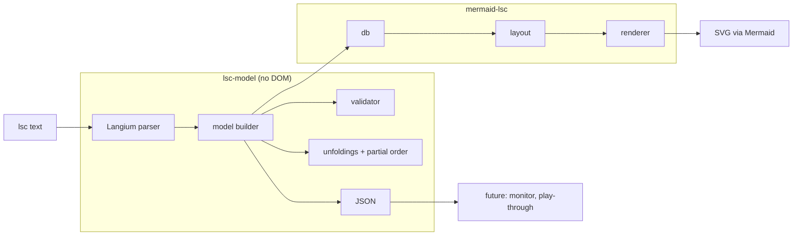

# Live Sequence Charts for Mermaid — Proposal

Oct 27, 2026 · @Thomas

## Summary

We propose a new Mermaid diagram type, `lsc`, that renders Live Sequence Charts (Damm & Harel, 2001) from text. Every construct in the notation maps to an LSC concept: chart mode, activation, pre-chart, hot and cold messages, locations and conditions, separately placed send and receive events, coregions, simultaneous regions and subcharts.

We found no open-source JavaScript tool that does this. We will build it first as an external Mermaid plugin, loaded the same way as ZenUML, and follow Mermaid's contribution conventions from the start. Once the notation has settled, we will open an RFC and then an upstream pull request.

The parser produces a semantic LSC model, not a list of drawing instructions. The renderer draws from that model. The same model can later feed validation, JSON export and runtime monitoring.

Page references are to Damm & Harel, "LSCs: Breathing Life into Message Sequence Charts", *Formal Methods in System Design* 19, 45–80, 2001.

## Goals and non-goals

The goal is a chart that is semantically an LSC, written as text and rendered in the browser.

**Goals**

- Every LSC concept in the 2001 paper can be written directly in text. No notes, colours or comments stand in for meaning.
- The text parses into a semantic model that matches the paper's abstract syntax: instances, locations, labels, temperatures and order (pp. 55–56).
- The renderer reproduces the paper's graphical conventions: dashed means provisional, solid means mandatory (p. 53).
- Charts embed in any page through Mermaid, with Mermaid's theming, accessibility and error reporting.
- Static checks catch ill-formed charts, for example a cyclic partial order, and report line and column.
- Mergeable upstream: built to Mermaid's reviewer checklist.

**Non-goals for the first release**

- Executing charts (play-out), model checking or synthesis.
- Real-time constraints, symbolic instances and the later Play-Engine extensions (kept as extension points).
- A graphical editor. Text is the source of truth.
- Multi-chart specifications in one Mermaid block. One block is one chart.

## Prior art

We found no JavaScript library that renders LSCs from text, so we will build one. Each of the closest tools lacks at least one of: runs on the web, uses a text notation, has LSC semantics.

| Tool | Form | Text notation | LSC semantics | Web/JS | Why it does not fit |
| --- | --- | --- | --- | --- | --- |
| [LaTeX `lsc` package](https://www.ctan.org/tex-archive/macros/latex/contrib/lsc) | TeX macros | Yes | Full 2001 language plus Klose and some Play-In extensions | No | Outputs PDF, not a web page. Useful as a reference for notation coverage. |
| [ScenarioTools / SML](https://cris.huji.ac.il/en/publications/scenariotools-a-tool-suite-for-the-scenario-based-modeling-and-an/) | Eclipse, Xtext | Yes | Extended LSC variant | No | Built for execution and synthesis, not rendering. |
| [PlayGo](https://wiki.weizmann.ac.il/playgo/index.php/About_PlayGo) | Eclipse product | No | UML-compliant LSC variant | No | Graphical IDE, compiles to AspectJ. |
| [Play-Engine](https://www.wisdom.weizmann.ac.il/~playbook) | Windows desktop application | No | Harel–Marelly LSCs | No | Research tool for play-in and play-out. |
| [LEC](https://sourceforge.net/projects/lec/) | Java Swing | No | Basic LSCs | No | Alpha-stage desktop editor. |
| Mermaid sequence, ZenUML, [mscgen\_js](https://mscgen.js.org/) | JS | Yes | None | Yes | No hot/cold, modes or pre-charts. Faking them with notes and colours loses the meaning. |

mscgen\_js is GPL-licensed. We write fresh code under MIT, Mermaid's licence, and take no code from it.

## Scope: which LSC dialect

Release 1 covers the whole 2001 paper. It also covers the constructs its figures use without formal semantics: instance creation and destruction, and timeouts.

| Layer | Constructs | Release |
| --- | --- | --- |
| Core (paper, formal semantics) | Chart mode, activation condition (including the activation message), pre-chart, instances, variables, visible events, synchronous and asynchronous messages with separate send and receive events, hot/cold messages, hot/cold locations, hot/cold conditions, shared conditions, simultaneous regions, coregions, environment | 1 |
| Paper, informal semantics | Subcharts (including subchart-local instances), iteration (constant, variable, unbounded), if-then-else, instance creation and destruction, timeouts | 1 (notation and rendering; semantics marked informal in the model) |
| Later LSC work | Forbidden elements, symbolic instances, time constraints, assignments (Harel–Marelly book); activation modes (Klose); UML Modal Sequence Diagrams (Harel–Maoz) | Extension points only |

The paper gives formal semantics only for basic charts. It omits "the formal semantics of subcharting, as well as that of iteration and branching" and does "not deal at all with instance creation and destruction, and timing issues" (p. 77). This proposal states its own readings of those constructs, and the model marks them as informal.

The notation reserves keywords for the later constructs, so adding them won't break existing charts.

## Element inventory

The notation needs 28 elements. Each row gives the element's meaning in the paper, how it is drawn, and the statement that writes it. The statements are specified in the next section. Rows marked *(ext.)* are drawing conventions of ours that no figure in the paper shows.

### Chart-level elements

| Element | Meaning (paper) | Drawn as | Statement |
| --- | --- | --- | --- |
| Universal chart | Every run that meets the activation must satisfy the chart (p. 51) | Solid frame | `lsc universal` |
| Existential chart | At least one run satisfies the chart; the default mode (pp. 47, 51) | Dashed frame (Fig. 3) | `lsc existential` (default) |
| Chart name | Identifies the chart (p. 60) | Header tab "LSC: name" | `title` |
| Activation condition | Snapshot condition that starts the chart (p. 51) | "AC: expr" line in the header tab (Figs. 8–14) | `activation when` |
| Activation message | "A simple kind of activation condition, which is really an activation message" (p. 51) | Dashed arrow entering the frame from outside; the receiver's line dashed above the frame (Fig. 2) | `activation on` |
| Pre-chart | Communication prefix that must be observed before the body applies (pp. 50, 54, 58) | Dashed hexagonal frame above the body frame, containing the instance heads (Fig. 4) | `prechart … end` |
| Visible events | Events the chart constrains without showing; in a universal chart they may not occur between the chart's events (pp. 49–50, Fig. 1) | Not drawn by the paper; optional "restricts:" line in the header *(ext.)* | `visible` |
| Visible variables | Variables the chart may refer to (p. 49) | Not drawn | `var` |

### Instance elements

| Element | Meaning | Drawn as | Statement |
| --- | --- | --- | --- |
| Instance | A process or object with its own timeline (p. 48) | Head box and vertical line | `instance` |
| Environment | Partner of messages with no named partner (p. 55) | The frame's left or right edge (Figs. 9–10) | reserved name `env` |
| Hot location | The instance must progress beyond this point (p. 54) | Solid line segment below the point | `hot progress` |
| Cold location | The instance may stop here (p. 54) | Dashed line segment below the point (Fig. 4) | `cold progress` |
| Coregion | Events on one instance with no order between them (pp. 55–56) | Dotted line parallel to the instance line (p. 55, Fig. 10) | `coregion … end` |
| Instance creation | Instance comes into existence mid-chart (Figs. 9–14) | Dashed "new" arrow to a head box drawn at that height | `create … by` |
| Instance destruction | Instance ends (Figs. 9–14) | X at the end of the line | `destroy` |

### Event and condition elements

| Element | Meaning | Drawn as | Statement |
| --- | --- | --- | --- |
| Synchronous message | Sender blocks until receipt (p. 70) | Solid (filled) arrowhead (p. 53) | `->>` |
| Asynchronous message | Sender continues after sending | Open arrowhead (p. 53) | `-)` |
| Separated send and receive | A message whose receipt is not the next event on the receiver: overtaking, crossing, or delays (pp. 55, 69–70) | Slanted arrow from the send row to the receive row (Figs. 9–10) | `send` … `receive` |
| Hot message | If sent, it must be received (p. 54) | Solid arrow line | `hot` prefix |
| Cold message | Receipt is not guaranteed (p. 54) | Dashed arrow line | `cold` prefix |
| Hot condition | Must hold when reached; otherwise the chart aborts and the run is rejected (pp. 53, 76) | Solid hexagon | `hot condition` |
| Cold condition | If false, exit the enclosing (sub)chart normally (p. 53) | Dashed hexagon | `cold condition` |
| Shared condition | One condition across several instances; a synchronisation barrier (pp. 55, 70) | One hexagon spanning those instances (Figs. 9–10) | `condition a, b: …` |
| Simultaneous region | Several messages and at most one condition at a single location (p. 55) | Events drawn on one row | `simultaneous … end` |
| Timeout | Statechart timeout notation, no timing semantics (p. 63) | Small self-loop labelled tm(n) (Figs. 9–10) | `timeout` |

### Structuring elements

| Element | Meaning | Drawn as | Statement |
| --- | --- | --- | --- |
| Subchart | A nested LSC over some of the parent's instances and possibly new ones; other lines are transparent to it (pp. 56, 63) | Solid frame with tab "Subchart: name"; only participating lines drawn inside | `subchart … end` |
| Iteration | Repeat a subchart a constant, variable or unbounded number of times (p. 56) | Multiplicity at the right of the subchart tab (`*`, `3`, `n`) *(ext.)* | `repeat` |
| If-then-else | Conditional branching (pp. 56, 63) | Two stacked compartments in one frame, each with its own tab; the guard on the first (Fig. 10) | `if … else … end` |

### Temperature, precisely

Temperature attaches to four things, and each does a different job (p. 54). A common mistake is to assume a hot message must be sent. In the paper it means only that if it is sent, it must be received. Whether it is sent depends on the temperature of the sender's location.

| Attached to | Hot | Cold |
| --- | --- | --- |
| Chart (mode) | Universal: all runs | Existential: at least one run |
| Location | Run must move beyond it | Run may stop here |
| Message | If sent, it will be received | Receipt not guaranteed |
| Condition | Must hold; otherwise the chart aborts and the run is rejected | If false, exit current (sub)chart |

Instance creation has no temperature. Its "new" arrow is always drawn dashed, as in Figs. 9–14, and whether it happens depends on the creator's location temperature.

Two idioms follow from these rules, so they don't need elements of their own:
- **Forbidden scenario.** A universal chart whose pre-chart is the scenario and whose body is `hot condition …: false` (pp. 47, 53).
- **While loop.** A `subchart repeat *` whose first statement is a cold condition (p. 56).

## Text notation specification

The notation is line-oriented, like Mermaid's sequence diagrams:
- one statement per line;
- blocks are closed by `end`;
- indentation is ignored;
- `%%` starts a comment.

Meaning lives in keywords. Nothing visual, such as colour or style, carries meaning.

### Design rules

1. **Temperature is a prefix.** Any element that has a temperature takes an optional `hot` or `cold` in front: `hot car ->> b: m`, `cold condition car: x`, `cold progress car`.
2. **Defaults are explicit and chart-wide.** Messages, locations and conditions default to `hot`. Every figure in the paper draws them this way, universal and existential alike (Figs. 2–4, 9–14). `defaults cold` switches a chart to the provisional reading, in which plain MSCs embed into LSCs (p. 57). Mode defaults to `existential` (p. 47).
3. **Maximal locations are cold.** The paper requires each instance's last location to be cold (p. 56). The default and every `progress` range stop just before it. A `hot progress` statement written for an instance that has no further location is a validation error.
4. **Text order is time order.** Each instance's events occur in the order they are written, except inside a coregion. Statements are laid out top to bottom in that order, and the text order must be one linearisation of the partial order ≤m.
5. **A message is one statement unless it is split.** `a ->> b: m` places the send and the receive on one row. `send a -) b: m` and a later `receive b: m` place them at separate points. In the paper, send and receive are separate locations paired by message name (p. 55). The one-line form is shorthand for a send immediately followed by its receive.
6. **Arrows encode synchrony only.** `->>` is synchronous (filled head) and `-)` is asynchronous (open head), matching Mermaid's sequence diagram and the paper's arrowheads (p. 53).

### Statement reference

| Statement | Syntax | Example |
| --- | --- | --- |
| Header (first line) | `lsc` \[`universal` \| `existential`\] | `lsc universal` |
| Title | `title` text | `title Car departure` |
| Accessibility | `accTitle:` text, `accDescr:` text | `accDescr: Departure handshake` |
| Defaults | `defaults` (`hot` \| `cold`) | `defaults cold` |
| Instances | `instance` id \[`as` "label"\] {`,` …} | `instance car as "Car", carHandler` |
| Variable | `var` \[inst`.`\]name `:` type | `var car.mode: {pass, stop}` |
| Visible event | `visible` message | `visible car ->> carHandler: arrivReq` |
| Activation condition | `activation when` expr | `activation when car.idle` |
| Activation message | `activation on` message | `activation on env ->> car: setDest` |
| Pre-chart | `prechart` … `end` | see examples |
| Message | \[temp\] from arrow to `:` name | `cold car -) cruiser: start` |
| Send | \[temp\] `send` from arrow to `:` name | `send client -) server: request` |
| Receive | `receive` inst \[`from` inst\] `:` name | `receive server: request` |
| Condition | \[temp\] `condition` inst {`,` inst} `:` expr | `cold condition car, proxSensor: cruising` |
| Location temperature | temp `progress` inst {`,` inst} | `cold progress car, carHandler` |
| Coregion | `coregion` inst … `end` | `coregion car` |
| Simultaneous region | `simultaneous` inst … `end` | `simultaneous car` |
| Subchart | `subchart` \["name"\] \[`over` insts\] \[`repeat` (`*` \| int \| var)\] … `end` | `subchart "Retry" repeat *` |
| Subchart-local instance | `instance` … inside a `subchart` | `instance logger` |
| If-then-else | `if` \["name"\] insts `:` expr … \[`else` \["name"\] …\] `end` | `if car: isEmpty` |
| Create | `create` id \[`as` "label"\] `by` inst | `create carHandler as "CarHandler" by terminal` |
| Destroy | `destroy` inst | `destroy carHandler` |
| Timeout | `timeout` inst `:` label | `timeout car: tm(90)` |

### Statement semantics in brief

- **`progress`** sets the temperature of the instance's current location and of each later location, up to but not including its maximal location. The current location is the instance's latest event, or the top of its line if it has none yet. The setting lasts until the next `progress` for that instance.
- **`activation on`** is an activation condition that holds in a snapshot where the named message event occurs (p. 51). It can be combined with `activation when`, in which case both must hold. It can also be combined with a `prechart`. The activation must hold before the pre-chart is even evaluated (p. 60). The activation message has no temperature and is always drawn as a dashed arrow (p. 51).
- **`visible`** adds events the chart constrains but does not show. In a universal chart, no visible event may occur between the chart's own events (p. 50).
- **`var`** declares a variable and makes it visible. The chart's visible variables are the declared variables plus every variable used in a condition (p. 49).
- **Instances** can also be implicit. An id first seen in a message is added as a chart-level instance, in order of appearance. An id first seen in `create` is a created instance and may not be used before that line. An `instance` declaration inside a subchart introduces an instance local to that subchart (p. 56).
- **`env`** is reserved. Messages to or from it are drawn to the nearer frame edge. A message with `env` as one endpoint is always a one-line message, because the environment has no locations.
- **`send` / `receive`** pairing: a `receive` matches the earliest unmatched `send` with the same name addressed to that instance. If the statement includes `from`, the send must also come from that instance. A `send` creates the sender's location. The matching `receive` creates the receiver's location. The message's temperature is written on the `send`.
- **`subchart`** covers the instances it names in `over`, or by default those used inside it, plus its local instances. The lines of other instances are transparent to it: they are not drawn inside its frame (p. 63).
- **`repeat *`** loops until a cold condition inside it is false. `repeat n` reads `n`, which must be a declared `int` variable, once on entry.
- **`if … else`** evaluates its guard once, as a cold condition. Exactly one branch runs. This is not the same as two sequential subcharts guarded by `c` and `not c`. Those re-evaluate the condition, and local computation steps in between may change it (p. 57), so both or neither might run.
- **`create` / `destroy`**: after `destroy x`, a later `create x` starts a new lifetime of `x` in the same column. Each lifetime is a distinct object.
- **Simultaneous partners.** In a `simultaneous` region, every partner event is placed on the region's row. If a partner takes part in more than one of the region's messages, those events form one simultaneous location on the partner as well.

### Labels and expressions

- **Message labels.** A message label is everything after `:` up to the end of the line. Its *name* is the leading identifier, and an optional `(…)` suffix is kept as argument text: `setDest(t3)` has the name `setDest`. Names identify events. `visible` declarations, pre-chart matching and `receive` pairing all match on the name.
- **Occurrence ids.** The paper assumes unique message names (p. 55). The model satisfies this by giving every message occurrence a unique id (`departReq`, `departReq#2`) and keeping the name unchanged for matching.
- **Condition expressions.** A condition expression is everything after `:` up to the end of the line. A small expression grammar parses it, with:
  - literals: `true`, `false`, integers and enum constants;
  - references: `inst.var` or an unqualified `var`;
  - operators: `= != < <= > >= and or not`, and parentheses.
- **Unqualified variables.** An unqualified variable resolves first against the condition's instances, then against global variables. If more than one variable matches, that is an error.
- **Value shorthand.** `inst.c` or a bare `c`, where `c` is a value of exactly one enum variable `v` on the condition's instances, abbreviates `inst.v = c`. A bare `b`, where `b` is a `bool` variable, abbreviates `b = true`. The paper uses this form: `AC: car.idle` means `car.state = idle` (pp. 49, 60).
- **Propositions.** A bare identifier that resolves to nothing is a named proposition. It is rendered as written, and validation treats it as opaque. This lets charts without declarations use readable conditions.
- **Navigation.** There is no navigation operator. `->` would clash with arrows, and the paper's `stops_at->isEmpty` refers to the car variable `isEmpty` (p. 49).

### Types

`bool`, `int`, `int[lo..hi]`, and enumerations `{a, b, c}`. Types are optional. When given, they enable checks on condition expressions and the value shorthand.

### Where statements may appear

| Context | Allowed |
| --- | --- |
| Chart top level | all body statements except `instance` |
| `prechart` | messages, `send`, `receive`, conditions, `progress`, `coregion`, `simultaneous` |
| `subchart`, `if`, `else` | all body statements, including nested structures and local `instance` |
| `coregion` | messages, `send`, `receive` and timeouts on that instance |
| `simultaneous` | messages touching that instance, and at most one condition |

Declarations (`title`, `defaults`, `instance`, `var`, `visible`, `activation`) must come before the first body statement.

### Grammar

```
chart        = header NL { decl NL } [ prechart NL ] { stmt NL }
header       = "lsc" [ "universal" | "existential" ]
decl         = "title" TEXT | "accTitle:" TEXT | "accDescr:" TEXT
             | "defaults" temp
             | "instance" inst { "," inst }
             | "var" [ ID "." ] ID ":" type
             | "visible" message
             | "activation" ( "when" EXPR | "on" message )
prechart     = "prechart" NL { stmt NL } "end"
stmt         = [ temp ] message
             | [ temp ] "send" message
             | "receive" ID [ "from" ID ] ":" TEXT
             | [ temp ] "condition" ids ":" EXPR
             | temp "progress" ids
             | "instance" inst { "," inst }
             | "coregion" ID NL { stmt NL } "end"
             | "simultaneous" ID NL { stmt NL } "end"
             | "subchart" [ STRING ] [ "over" ids ] [ "repeat" ( "*" | INT | ID ) ] NL { stmt NL } "end"
             | "if" [ STRING ] ids ":" EXPR NL { stmt NL } [ "else" [ STRING ] NL { stmt NL } ] "end"
             | "create" ID [ "as" STRING ] "by" ID
             | "destroy" ID
             | "timeout" ID ":" TEXT
message      = endpoint arrow endpoint ":" TEXT
endpoint     = ID | "env"
arrow        = "->>" | "-)"
temp         = "hot" | "cold"
inst         = ID [ "as" STRING ]
ids          = ID { "," ID }
type         = "bool" | "int" [ "[" INT ".." INT "]" ] | "{" ID { "," ID } "}"
```

The validator enforces the context rules from the table above, not the grammar. That way an error can say what is allowed instead of just failing to parse.

### Reserved words

In use: `lsc universal existential title defaults instance as var visible activation when on prechart end hot cold progress send receive from condition coregion simultaneous subchart over repeat if else create by destroy timeout env true false and or not bool int`.

Reserved for later LSC extensions: `forbidden symbolic assign within delay sync initial invariant iterative`.

## Worked examples

Each example encodes a figure from the paper, apart from the last two. Together they cover every element in the inventory and become the first test fixtures.

### Fig. 1 — visible events

Fig. 1 shows only messages. We write it as a universal chart to show the effect the paper describes: arrival messages must not occur while a car is departing (p. 50). The paper's own event list makes these messages synchronous (pp. 49–50).

```
lsc universal
  title Visible events
  instance car, carHandler, destPanel, passenger
  visible car ->> carHandler: arrivReq
  visible carHandler ->> car: arrivAck

  env ->> car: setDest
  car ->> carHandler: departReq
  passenger ->> destPanel: pressButton
  carHandler ->> car: departAck
  destPanel ->> passenger: flashSign
```

### Fig. 2 — universal chart with an activation message

```
lsc universal
  title Car departure
  instance cruiser, car, carHandler
  activation on env ->> car: setDest

  car ->> carHandler: departReq
  carHandler ->> car: departAck
  car ->> cruiser: start
  cruiser ->> car: started
  car ->> cruiser: engage
```

### Fig. 3 — existential chart

```
lsc existential
  title Car stopping at terminal
  instance proxSensor, cruiser, car, carHandler

  car ->> carHandler: arrivReq
  carHandler ->> car: arrivAck
  proxSensor ->> car: alertStop
  car ->> cruiser: disengage
  car ->> cruiser: stop
```

### Fig. 4 — pre-chart and cold locations

```
lsc universal
  title Perform approach
  instance proxSensor, car, carHandler

  prechart
    carHandler ->> car: departAck
    proxSensor ->> car: alert100
  end

  car ->> carHandler: arrivReq
  cold progress car, carHandler
  carHandler ->> car: arrivAck
```

After `arrivReq`, both lines are cold, so `arrivAck` may never be sent. The terminal may be closed, or all its platforms full (p. 54).

### Fig. 10 — full car behaviour

This example uses subcharts, a shared condition, coregions, timeouts, creation and destruction, and if-then-else. The variables are the car's, as declared on p. 49. The conditions `idle`, `departure`, `cruising`, `arrival` and `isEmpty` use the value shorthand.

```
lsc universal
  title Car behavior
  instance destPanel as "DestPanel", terminal as "Terminal"
  instance controlCenter as "Control Center", cruiser as "Cruiser"
  instance car as "Car", carHandler as "CarHandler"
  instance proxSensor as "Proximity Sensor"
  var car.mode: {pass, stop}
  var car.isEmpty: bool
  var car.state: {idle, departure, cruising, arrival}
  activation when car.idle

  subchart "car leaving terminal - called from another terminal"
    cold condition car: idle
    env ->> destPanel: buttonPressed
    destPanel ->> terminal: callCar
    terminal ->> controlCenter: sendCar
    controlCenter ->> car: setDest
    timeout car: tm(90)
    condition car: departure
  end

  subchart "Perform departure"
    cold condition car: departure
    coregion car
      car ->> carHandler: departReq
      car ->> cruiser: start
    end
    coregion car
      carHandler ->> car: departAck
      cruiser ->> car: started
    end
    car ->> cruiser: engage
    condition car: cruising
    destroy carHandler
  end

  condition car, proxSensor: cruising
  proxSensor ->> car: alert100

  subchart "Perform approach"
    cold condition car: arrival
    car ->> terminal: arrivReq
    create carHandler as "CarHandler" by terminal
    carHandler ->> car: arrivAck

    subchart "Stopping at terminal"
      cold condition car: mode = stop
      proxSensor ->> car: alertStop
      car ->> cruiser: disengage
      if "Stop at terminal" car: isEmpty
        car ->> cruiser: stop
        condition car: idle
      else "Temporary stop at terminal"
        timeout car: tm(90)
        condition car: departure
      end
    end

    subchart "Pass through terminal"
      cold condition car: mode = pass
      car ->> carHandler: departReq
      carHandler ->> car: departAck
      condition car: cruising
      destroy carHandler
    end
  end
```

The figure groups the coregions as two sends `{departReq, start}` followed by two receives `{departAck, started}`. CarHandler is destroyed in "Perform departure" and re-created by Terminal in "Perform approach", which starts its second lifetime.

### Crossing and overtaking messages

This example isn't from a figure. It shows the two orders that one-line messages can't express. Here `request` and `notify` cross, and `second` overtakes `first`.

```
lsc existential
  title Crossing and overtaking
  instance client, server

  send client -) server: request
  send server -) client: notify
  receive server: request
  receive client: notify

  send client -) server: first
  send client -) server: second
  receive server: second
  receive server: first
```

### Forbidden scenario idiom

```
lsc universal
  title No arrival request while departing
  instance car, carHandler

  prechart
    car ->> carHandler: departReq
    car ->> carHandler: arrivReq
  end

  condition car: false
```

If the pre-chart is ever observed, the hot `false` condition aborts the chart and the run is rejected. The scenario is therefore forbidden, and no new element is needed (pp. 47, 53).

## Rendering specification

The renderer follows the paper's visual rule: solid lines mean mandatory and dashed lines mean provisional (p. 53). Arrowheads show synchrony and nothing else.

### Visual vocabulary

| Element | Hot / mandatory | Cold / provisional |
| --- | --- | --- |
| Chart frame (mode) | Solid (universal) | Dashed (existential) |
| Instance line segment | Solid | Dashed |
| Message line | Solid | Dashed |
| Condition hexagon | Solid | Dashed |

| Element | Drawing |
| --- | --- |
| Synchronous / asynchronous | Filled / open arrowhead |
| Pre-chart | Dashed hexagonal frame (p. 54) |
| Activation message | Dashed arrow from outside the frame (p. 51) |
| Coregion | Dotted line parallel to the instance line (p. 55) |
| Creation | Dashed "new" arrow to a head box |
| Destruction | X ending the line |

The dashed pattern serves several purposes besides temperature, and dotted coregions sit next to dashed cold segments. To keep them distinguishable, coregions also get short end ticks, and the `temperatureCue` option adds a non-line cue.

### Layout

- **Columns.** One per instance, in declaration order, then in order of first appearance. A subchart-local instance gets its own column, but its line is drawn only inside its subchart.
- **Head boxes.** Head boxes sit inside the body frame at the top (Figs. 2, 9). When there is a pre-chart, they sit inside the pre-chart hexagon instead (Fig. 4).
- **Rows.** One per statement, in text order. A one-line message is drawn horizontally on its row. A split message is drawn as a slanted arrow from its `send` row to its `receive` row. A `simultaneous` region shares one row. Coregion events take consecutive rows, with a dotted line beside the instance.
- **Header tab.** Top-left: "LSC: title", then "AC: expr" for an activation condition, then an optional "restricts:" line listing visible events.
- **Activation message.** A dashed arrow entering the frame from outside, with the receiver's line drawn dashed above the frame (Fig. 2). When the sender is a named instance, its line also extends dashed above the frame and the arrow runs between the two extensions.
- **Environment.** Messages to or from `env` end at the nearer frame edge (Figs. 9–10).
- **Shared conditions.** One hexagon from the leftmost to the rightmost sharer. The lines of any instances between them that do not share it are drawn over the hexagon.
- **Subcharts.** A frame over the participating columns, with a tab "Subchart: name" and the multiplicity (`*`, `3`, `n`) at the tab's right. Lines of non-participating instances are not drawn inside the frame (p. 63). A cold condition that opens a subchart is drawn across the frame's top border, attached from inside (p. 60).
- **If-then-else.** One frame split into two compartments, each with its own tab. The guard is drawn on the first compartment's top border (Fig. 10).
- **Creation and destruction.** A dashed "new" arrow from the creator to a head box drawn at that row. An X ends a destroyed line. Each later lifetime starts with a new head box in the same column.
- **Timeouts.** A small self-loop to the right of the line, labelled as written (`tm(90)`).

### Theming, configuration and accessibility

- All colours come from theme variables. The diagram defines `lscFrameColor`, `lscHotColor`, `lscColdColor` and `lscConditionFill`. Their defaults are derived from Mermaid's existing variables (`lineColor`, `primaryColor`, `mainBkg`, `textColor`), and users can override them through `themeVariables`. At port time they are added to all five themes.
- An `lsc` config block holds:
  - `showVisibleEvents`: default true for universal charts;
  - `temperatureCue`: `line`, `line+color` or `line+badge`, for readers who can't rely on dash patterns;
  - `showDiagnostics`;
  - `rowHeight`, `instanceSpacing`, `mirrorInstances` and `useMaxWidth`.
- The diagram id is `liveSequenceChart`, which Mermaid uses as the ARIA role description. When no `accDescr` is given, one is generated from the model, for example "Universal chart, 3 instances, 5 messages, activated by setDest".
- Hand-drawn mode must keep dashed, dotted and solid lines distinguishable, or it uses `line+badge` automatically. If neither works, the docs say so, as Mermaid allows.

## Semantic model and public API

The parser builds a model shaped like the paper's abstract syntax (pp. 55–56 and Appendix A). The chart is then data that tools can reason about, not just a picture.

### Model

```ts
type Temp = 'hot' | 'cold';
type LocRef = { instance: string; index: number };      // ⟨i, l⟩

interface LscChart {
  modelVersion: 1;
  mode: 'universal' | 'existential';                   // mod(m)
  title?: string; accTitle?: string; accDescr?: string;
  defaults: Temp;
  instances: Instance[];                               // inst(m), in column order
  variables: Variable[];                               // declared part of vis_var(m)
  visibleEvents: EventSpec[];                          // vis_events(m) beyond those drawn
  activation?: { condition?: Expr; message?: EventSpec };   // ac(m)
  prechart?: Region;                                   // pch(m)
  body: Region;
  messages: Message[];
  conditions: Condition[];
}

interface Instance {
  id: string; label: string;
  scope: 'chart' | { subchart: string };               // subchart-local instances
  locations: Location[];                               // dom(m, i), index = position
  lifetimes: Lifetime[];                               // one entry unless re-created
}
interface Lifetime { createdAt?: LocRef; createdBy?: string; destroyedAt?: LocRef }

interface Location {
  ref: LocRef;
  temp: Temp;                                          // temp(m)(⟨i, l⟩)
  orderedWithNext: boolean;                            // order(m): false = no order to ⟨i, l+1⟩
  label: LocationLabel;                                // label(m)
  row: number;                                         // layout row
  span: SourceSpan;                                    // line and column, for errors
}
interface LocationLabel {
  events: MessageEvent[];                              // ℘(Messages)
  condition?: string;                                  // Condition.id
  create?: string;                                     // instance created here
  destroy?: true;
  timeout?: string;
}

interface Message {
  id: string;                                          // unique occurrence id
  name: string; args?: string; text: string;           // name is the event identity
  from: string; to: string;                            // instance id or 'env'
  kind: 'synch' | 'asynch'; temp: Temp;
  send?: LocRef; receive?: LocRef;                     // absent on the env side
}
interface MessageEvent { message: string; dir: '!' | '?' }   // Message.id
interface EventSpec { from: string; to: string; name: string; kind: 'synch' | 'asynch' }
interface Condition { id: string; instances: string[]; expr: Expr; temp: Temp; locations: LocRef[] }

interface Variable { instance?: string; name: string; type?: Type }
type Type = { kind: 'bool' } | { kind: 'int'; lo?: number; hi?: number }
          | { kind: 'enum'; values: string[] };
type Expr = { kind: 'bool'; value: boolean } | { kind: 'int'; value: number }
          | { kind: 'ref'; instance?: string; name: string }     // resolved variable
          | { kind: 'const'; name: string }                      // enum constant
          | { kind: 'prop'; name: string }                       // opaque proposition
          | { kind: 'not'; arg: Expr }
          | { kind: 'bin'; op: '=' | '!=' | '<' | '<=' | '>' | '>=' | 'and' | 'or';
              left: Expr; right: Expr };

type RegionItem = { kind: 'row'; locations: LocRef[] } | Subchart | Alternative;
interface Region { items: RegionItem[] }
interface Subchart { kind: 'subchart'; id: string; name?: string; instances: string[];
                     localInstances: string[]; repeat?: '*' | number | string;
                     body: Region; semantics: 'informal' }
interface Alternative { kind: 'alt'; id: string; name?: string; elseName?: string;
                        guard: Condition; then: Region; else?: Region; semantics: 'informal' }
```

### Derived structures

- **Unfoldings.** A basic chart obtained by:
  - taking every subchart once (a `repeat` is one pass);
  - choosing one branch of each `if … else`;
  - assuming no cold condition fails.

  A chart has one unfolding per combination of branch choices. The number of unfoldings is capped (default 256). When the cap is reached, the remaining ones are skipped and a warning is issued.
- **Partial order ≤m.** Computed for each unfolding with the four rules of Appendix A.1 (pp. 69–70):
  - order along an instance line, except where `orderedWithNext` is false;
  - send before receive;
  - a synchronous receive comes before the sender's next location;
  - shared conditions act as a barrier.

  Our reading for creation adds one more rule: the creator's create location comes before the created lifetime's first location.
- **Well-formedness.** ≤m is acyclic in every unfolding, and the text order is a linearisation of it (p. 70).
- **Cuts.** One location per instance, consistent with ≤m (p. 71). Needed later for monitoring and animated play-through.

For a chart without subcharts, alternatives or creation, there is exactly one unfolding, and ≤m is the paper's formal partial order.

### Public API

| Function | Returns | Release |
| --- | --- | --- |
| `parseLsc(text)` | `{ model, diagnostics }` | 1 |
| `validateLsc(model)` | diagnostics with severity and source span | 1 |
| `unfoldings(model)` | the basic charts described above | 1 |
| `partialOrder(model, unfolding?)` | the relation plus a topological layering | 1 |
| `toJSON(model)` / `fromJSON(json)` | a stable, versioned JSON form | 1 |
| Mermaid diagram definition `lsc` | parser, db, renderer, styles | 1 |
| `skeletonAutomaton(model)` | the transition system of Appendix A.2, for monitors | later |

The model package has no rendering or DOM dependencies, so it also runs in Node, in tests and in a future monitor.

## Static validation rules

The validator turns the paper's well-formedness conditions into diagnostics with line and column.

Inside Mermaid, only syntax errors and the rules marked ✱ stop rendering, because without them the chart can't be laid out. All other findings are returned by `validateLsc`. With `showDiagnostics` on, the renderer also marks them on the diagram. This keeps charts visible in live editors while they are being written.

| # | Rule | Source | Severity |
| --- | --- | --- | --- |
| V1 | ≤m is acyclic in every unfolding | A.1, p. 70 | Error |
| V2 | Maximal locations are cold; `hot progress` for an instance with no further location is rejected | p. 56 | Error |
| V3 | At most one condition per location, including inside `simultaneous` | p. 55 | Error |
| V4 | At most one `activation on` and at most one `activation when` | p. 51 | Error |
| V5 | Text order is a linearisation of ≤m; for example, a synchronous sender may not act between its `send` and the matching `receive` | A.1, p. 70 | Error |
| V6 ✱ | Every instance in a condition, coregion, simultaneous region, subchart `over` list, `receive`, `create … by` or `destroy` exists, or is `env` where allowed | p. 55 | Error |
| V7 | A subchart's `over` list includes every chart-level instance used inside it | p. 56 | Error |
| V8 | A created instance is used only within its lifetimes; `create x` requires that no lifetime of `x` is open, in every unfolding | Figs. 9–14 | Error |
| V9 | No events on an instance after its `destroy`, until it is re-created | Figs. 9–14 | Error |
| V10 | A `coregion` holds at least two events, all on its instance | pp. 55–56 | Error |
| V11 | `repeat *` contains a cold condition; otherwise it can end only by aborting | p. 56 | Warning |
| V12 | A universal chart with no activation and no pre-chart applies at every point of every run | p. 51 | Warning |
| V13 | An explicit `hot condition` in a pre-chart acts as a cold one: when it fails, the chart is simply not activated | p. 58 | Info |
| V14 | Condition expressions type-check against declared variables, when types are given; an ambiguous unqualified variable is an error | p. 55 | Error |
| V15 | Synchronous messages to or from `env` add no ordering constraint | A.1, p. 70 | Info |
| V16 | Repeated message names get distinct occurrence ids | p. 55 | Info |
| V17 | A `create` may find an instance still alive because a cold exit skipped its `destroy` | Figs. 9–10 | Warning |
| V18 | A `repeat` variable is a declared `int` | p. 56 | Error |
| V19 ✱ | Every `send` has exactly one matching `receive`, and every `receive` a preceding `send` | p. 55 | Error |
| V20 | `send` and `receive` connect named instances, never `env` | p. 55 | Error |
| V21 | A condition identifier that resolves to no variable is treated as an opaque proposition (reported when the chart declares variables) | p. 55 | Info |

One check from the paper needs a model of the system, so it is out of scope. That is the "healthiness" check: at least one run must eventually reach a point where a universal chart's activation and pre-chart are satisfied (p. 51).

## Architecture and Mermaid integration

There are two packages: a DOM-free model library, and a thin Mermaid plugin that renders from it.



The model is the centre. The plugin's db holds a fresh model for each render, and future tools read the same model without Mermaid.

### Packages

| Package | Contents | Depends on | Licence |
| --- | --- | --- | --- |
| `lsc-model` | Langium grammar and parser, model, validator, unfoldings, partial order, JSON | Langium | MIT |
| `mermaid-lsc` | Detector, loader, db, layout, renderer, styles | `lsc-model`; Mermaid as a peer | MIT |

### Using the plugin in a page

```html
<script type="module">
  import mermaid from 'https://cdn.jsdelivr.net/npm/mermaid@11/dist/mermaid.esm.min.mjs';
  import lsc from 'https://cdn.jsdelivr.net/npm/mermaid-lsc/dist/mermaid-lsc.esm.mjs';
  await mermaid.registerExternalDiagrams([lsc]);
  mermaid.initialize({ startOnLoad: true });
</script>

<pre class="mermaid">
lsc universal
  title Car departure
  activation on env ->> car: setDest
  car ->> carHandler: departReq
  carHandler ->> car: departAck
</pre>
```

ZenUML is loaded the same way. The package name `mermaid-lsc` is a placeholder.

### Conventions adopted from day one

We build to Mermaid's [new-diagram guide](https://mermaid.js.org/community/new-diagram.html) from the start, so that the upstream port needs little rework:

- A Langium grammar, matching Mermaid's newer diagrams in `@mermaid-js/parser`. Errors report line and column, and users never see a stack trace.
- The db is a getter that returns a new instance, so no state leaks between two charts on one page.
- Colours come only from theme variables.
- Viewport sizing honours `useMaxWidth`.

An external plugin can't import Mermaid's internals. The plugin keeps local equivalents of the following behind one adapter module, and swaps them for the in-tree versions at port time:
- the `commonDb` title and accessibility setters;
- the SVG sizing helper;
- theme-variable registration;
- the config schema;
- the RoughJS hand-drawn path.

### Upstream layout

At port time:
- the grammar moves to `packages/parser/src/language/lsc/`;
- the model, validator, db, renderer and styles move to `packages/mermaid/src/diagrams/lsc/`.

`lsc-model` continues to be published from this repository for users outside Mermaid. How the two copies are kept in sync, and who publishes which, is agreed in the RFC before the port starts.

## Roadmap and upstreaming plan

There are five phases, each closed by a gate. The plugin from Phase 2 is useful on its own, so the plan pays off even if the upstream PR stalls.

| Phase | Work | Gate to the next phase |
| --- | --- | --- |
| 0. Notation | Finalise grammar, examples and decisions D1–D6; write all worked examples as fixtures | Fixtures reviewed against the paper's figures; notation frozen for release 1 |
| 1. Model library | `lsc-model`: parser, model, validator, unfoldings, partial order, JSON | Every fixture parses, validates and round-trips through JSON; every V-rule has a positive and negative test |
| 2. Mermaid plugin | `mermaid-lsc`: layout, renderer, theming, accessibility, docs site | Published plugin renders every fixture; visual regression baselines approved |
| 3. Upstream port | RFC issue, then port into Mermaid per the checklist below | RFC accepted by maintainers; PR merged as `lsc-beta` |
| 4. Beyond release 1 | `skeletonAutomaton`, runtime monitor, animated play-through, later LSC extensions | (open) |

Phase 0 comes first because the notation is the hardest thing to change once people have written charts in it. No dates are set yet; they depend on who staffs the work.

### Phase 3 checklist

The port follows Mermaid's reviewer checklist. These items need work beyond moving code:

- [ ] Langium grammar in `packages/parser`, with parser tests
- [ ] `.mmd` visual regression fixtures in `e2e/diagrams/lsc/`, one per worked example
- [ ] Syntax page under `src/docs/syntax/`, with a docs spec that parses every example
- [ ] Demo page linked from `demos/index.html`
- [ ] An entry in `@mermaid-js/examples`, one marked default
- [ ] Config options in `config.schema.yaml`, types regenerated
- [ ] Theme variables added to all five themes
- [ ] New keywords added to `.cspell/mermaid-terms.txt`
- [ ] Hand-drawn mode implemented, or its absence documented
- [ ] Changeset (`minor`, `feat:`) and a PR against `develop` linked to the RFC issue

## Risks and open questions

### Decisions needed before Phase 1

| # | Question | Proposed answer | Alternative |
| --- | --- | --- | --- |
| D1 | Default temperature when none is written | `hot`, matching every figure in the paper; `defaults cold` for the provisional reading | `cold`, the reading in which plain MSCs embed (p. 57); MSC-style text stays valid but hot charts get verbose |
| D2 | Diagram keyword | `lsc`, shipped upstream as `lsc-beta` during beta, as Mermaid has done for newer diagrams | `liveSequenceDiagram`, closer to `sequenceDiagram` |
| D3 | How temperature is written | `hot` / `cold` prefix keywords | Arrow variants (`-->>` dashed = cold); shorter, but the core concept becomes punctuation |
| D4 | One chart per block, or a multi-chart specification | One chart per block | A `spec` block holding several charts with shared declarations |
| D5 | A shared condition across non-adjacent instances | Draw the hexagon across, with non-sharing lines drawn over it | Reorder columns automatically so that sharers are adjacent |
| D6 | Forbidden elements from the Harel–Marelly book in release 1 | No; the idiom covers forbidden scenarios | Add a `forbidden` block now |

### Risks

| Risk | Effect | Mitigation |
| --- | --- | --- |
| Mermaid maintainers decline a niche diagram | No upstream merge | The external plugin is a complete product on its own; open an RFC issue before investing in the port |
| The paper leaves subcharts, branching, creation and timeouts informal (p. 77) | Disputes over meaning | The model marks them `semantics: 'informal'`; this document states our readings; they are kept isolated so they can change |
| Mermaid's diagram conventions keep moving (Langium migration, rendering utilities) | Rework at port time | Track the `develop` branch; keep Mermaid-specific code behind the adapter module |
| Ownership of `lsc-model` after the port | Two copies drift, or maintainers refuse a second package | Agree on sync and publishing in the RFC; one source of truth with a release-time copy |
| Bundle size inside Mermaid core | Maintainers reject the validator or partial-order code | Diagram chunks load lazily; keep the validator tree-shakable and optional in the Mermaid build |
| Unfoldings grow exponentially with the number of `if … else` | Slow validation on large charts | Cap with a warning (default 256); most charts have few alternatives |
| Dashed versus solid is the main temperature cue, and dotted coregions sit next to dashed lines | Hard to read at small sizes, in hand-drawn mode, and for some readers | Coregion end ticks; optional secondary cue (theme colour or H/C badge); test hand-drawn mode early |
| Layout of nested subcharts, coregions, slanted messages and shared conditions | Overlaps and crossings | Text-order layout, fixed rules, visual regression fixtures from every paper figure |
