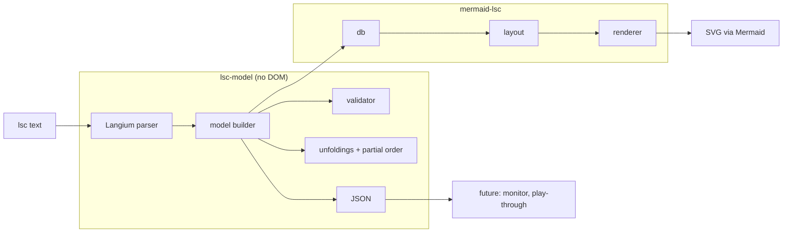

# Live Sequence Charts for Mermaid — Proposal

Oct 27, 2026 · @Thomas

## Summary

We propose a new Mermaid diagram type that renders Live Sequence Charts (Damm & Harel, 2001) from text. While the notation may still change, its keyword is `lsc-alpha`; it becomes `lsc` once the notation is declared stable. Every construct in the notation maps to an LSC concept: chart mode, activation, pre-chart, hot and cold messages, locations and conditions, separately placed send and receive events, coregions, simultaneous regions and subcharts.

We found no open-source JavaScript tool that does this. We will build it first as an external Mermaid plugin, loaded the same way as ZenUML, and follow Mermaid's contribution conventions from the start. Once the notation has settled, we will open an RFC and then an upstream pull request.

The parser produces a semantic LSC model, not a list of drawing instructions. The renderer draws from that model. The same model can later feed validation, JSON export and runtime monitoring.

Page references are to Damm & Harel, "LSCs: Breathing Life into Message Sequence Charts", *Formal Methods in System Design* 19, 45–80, 2001.

## Goals and non-goals

The goal is a chart that is semantically an LSC, written as text and rendered in the browser.

**Goals**

- Every construct of a single chart in the 2001 paper can be written directly in text. No notes, colours or comments stand in for meaning.
- The text parses into a semantic model that matches the paper's abstract syntax: instances, locations, labels, temperatures and order (pp. 55–56).
- Where the paper is informal or its appendix is incomplete, this document states the reading it adopts, with page references (§Semantic readings).
- The renderer reproduces the paper's graphical conventions: dashed means provisional, solid means mandatory (p. 53).
- Charts embed in any page that loads Mermaid and the plugin, with Mermaid's theming, accessibility and error reporting. A command-line renderer produces static SVG for sites that can't load Mermaid plugins, such as GitHub, GitLab and Obsidian.
- Static checks catch ill-formed charts, for example a cyclic partial order, and report line and column.
- Mergeable upstream: built to Mermaid's reviewer checklist.

**Non-goals for the first release**

- Executing charts (play-out), model checking or synthesis.
- Real-time constraints, symbolic instances and the later Play-Engine extensions (kept as extension points).
- A graphical editor. Text is the source of truth.
- Multi-chart specifications in one Mermaid block, and references from one chart to another. One block is one chart. The keyword `ref` is reserved for chart references.

## Prior art

We found no JavaScript library that renders LSCs from text, so we will build one. Each of the closest tools lacks at least one of: runs on the web, uses a text notation, has LSC semantics.

| Tool | Form | Text notation | LSC semantics | Web/JS | Why it does not fit |
| --- | --- | --- | --- | --- | --- |
| [LaTeX `lsc` package](https://www.ctan.org/tex-archive/macros/latex/contrib/lsc) | TeX macros | Yes | Full 2001 language plus Klose and some Play-In extensions | No | Outputs PDF, not a web page. Useful as a reference for notation coverage. |
| [ScenarioTools / SML](https://cris.huji.ac.il/en/publications/scenariotools-a-tool-suite-for-the-scenario-based-modeling-and-an/) | Eclipse, Xtext | Yes | Extended LSC variant | No | Built for execution and synthesis, not rendering. |
| [PlayGo](https://wiki.weizmann.ac.il/playgo/index.php/About_PlayGo) | Eclipse product | No | UML-compliant LSC variant | No | Graphical IDE, compiles to AspectJ. |
| [Play-Engine](https://www.wisdom.weizmann.ac.il/~playbook) | Windows desktop application | No | Harel–Marelly LSCs | No | Research tool for play-in and play-out. |
| [LEC](https://sourceforge.net/projects/lec/) | Java Swing | No | Basic LSCs | No | Alpha-stage desktop editor. |
| Mermaid sequence, ZenUML, [mscgen\_js](https://mscgen.js.org/) | JS | Yes | None | Yes | No hot/cold, modes or pre-charts. Faking them with notes and colours loses the meaning. |

mscgen\_js is GPL-licensed. We write fresh code under MIT, Mermaid's licence, and take no code from it.

## Scope: which LSC dialect

Release 1 covers every construct of a single chart in the 2001 paper. It also covers the constructs its figures use without formal semantics: instance creation and destruction, timeouts, and standalone subcharts (Fig. 11).

| Layer | Constructs | Release |
| --- | --- | --- |
| Core (paper, formal semantics) | Chart mode, activation condition (including the activation message), pre-chart, instances, variables, visible events, synchronous and asynchronous messages with separate send and receive events, hot/cold messages, hot/cold locations, hot/cold conditions, shared conditions, simultaneous regions, coregions, environment | 1 |
| Paper, informal semantics | Subcharts (including subchart-local instances and standalone subcharts), iteration (constant, variable, unbounded), if-then-else, instance creation and destruction, timeouts | 1 (notation, rendering and the readings in §Semantic readings; marked informal in the model) |
| Later LSC work | Forbidden elements, symbolic instances, time constraints, assignments (Harel–Marelly book); activation modes (Klose); UML Modal Sequence Diagrams (Harel–Maoz); chart references | Extension points only |

The paper gives formal semantics only for basic charts. It omits "the formal semantics of subcharting, as well as that of iteration and branching" and does "not deal at all with instance creation and destruction, and timing issues" (p. 77). §Semantic readings states how this notation reads those constructs, and the model marks them as informal.

The notation reserves keywords for the later constructs, so adding them won't break existing charts.

## Element inventory

Each row gives the element's meaning in the paper, how it is drawn, and the statement that writes it. The statements are specified in §Text notation specification. Rows marked *(ext.)* are conventions of ours that no figure in the paper shows.

### Chart-level elements

| Element | Meaning (paper) | Drawn as | Statement |
| --- | --- | --- | --- |
| Universal chart | Every run that meets the activation must satisfy the chart (p. 51) | Solid frame | `lsc-alpha universal` |
| Existential chart | At least one run satisfies the chart (pp. 47, 51) | Dashed frame (Fig. 3) | `lsc-alpha existential` |
| Standalone subchart | A subchart drawn on its own (Fig. 11) | Solid frame with tab "Subchart: name" | `lsc-alpha subchart` |
| Chart name | Identifies the chart (p. 60) | Header tab "LSC: name" | `title` |
| Activation condition | Snapshot condition that starts the chart (p. 51) | "AC: expr" line in the header tab (Figs. 8–14) | `activation when` |
| Activation message | "A simple kind of activation condition, which is really an activation message", drawn as "a dashed cold message arrow"; the chart starts when the message is received (p. 51) | Dashed arrow entering the frame from outside; the receiver's line dashed above the frame (Fig. 2) | `activation on` |
| Pre-chart | Communication prefix that must be observed before the body applies (pp. 50, 54, 58) | Dashed hexagonal frame above the body frame, containing the instance heads (Fig. 4) | `prechart … end` |
| Visible events | Events the chart constrains without showing; they may not occur out of place while the chart is active (pp. 49–50, Fig. 1) | Not drawn by the paper; optional "visible:" line in the header *(ext.)* | `visible` |
| Visible variables | Variables the chart may refer to (p. 49) | Not drawn | `var` |

### Instance elements

| Element | Meaning | Drawn as | Statement |
| --- | --- | --- | --- |
| Instance | A process or object with its own timeline (p. 48) | Head box and vertical line | `instance` (also `participant`, `actor`) |
| Environment | Partner of messages with no named partner (p. 55) | The frame's left or right edge (Figs. 9–10) | reserved name `env` |
| Hot location | The instance must progress beyond this point (p. 54) | Solid line segment below the point | `hot progress` |
| Cold location | The instance may stop here (p. 54) | Dashed line segment below the point (Fig. 4) | `cold progress` |
| Coregion | Events on one instance with no order between them (pp. 55–56) | Dotted line parallel to the instance line (p. 55, Fig. 10) | `coregion … end` |
| Instance creation | Instance comes into existence mid-chart (Figs. 9–14) | Dashed arrow labelled "new" to a head box drawn at that height | `create … by` |
| Instance destruction | Instance ends (Figs. 9–14) | X at the end of the line | `destroy` |

### Event and condition elements

| Element | Meaning | Drawn as | Statement |
| --- | --- | --- | --- |
| Synchronous message | Sender blocks until receipt (p. 70) | Solid (filled) arrowhead (p. 53) | `->>` |
| Asynchronous message | Sender continues after sending | Open arrowhead (p. 53) | `-)` |
| Separated send and receive | Send and receive are separate locations, paired by message (p. 55). Writing them apart expresses crossing, overtaking and delays *(ext.)* | Slanted arrow from the send row to the receive row *(ext.)* | `send` … `receive` |
| Self-message | A message from an instance to itself: a send location, then a receive location *(ext.)* | Rounded self-loop with the message's arrowhead and label | `a ->> a: m` |
| Hot message | If sent, it must be received (p. 54) | Solid arrow line | `hot` prefix |
| Cold message | Receipt is not guaranteed (p. 54) | Dashed arrow line | `cold` prefix |
| Hot condition | Must hold; otherwise the chart aborts and the run is rejected (pp. 53, 76) | Solid hexagon | `hot condition` |
| Cold condition | If false, exit the enclosing (sub)chart normally (p. 53) | Dashed hexagon | `cold condition` |
| Shared condition | One condition across several instances; a synchronisation barrier (pp. 55, 70) | One hexagon spanning those instances (Figs. 9–10) | `condition a, b: …` |
| Simultaneous region | Several messages and at most one condition at a single location (p. 55) | Events drawn on one row | `simultaneous … end` |
| Timeout | Statechart timeout notation, no timing semantics (p. 63) | Square-cornered self-loop labelled tm(n) (Figs. 9–10) | `timeout` |

### Structuring elements

| Element | Meaning | Drawn as | Statement |
| --- | --- | --- | --- |
| Subchart | A nested LSC over some of the parent's instances and possibly new ones; other lines are transparent to it (pp. 56, 63) | Solid frame with tab "Subchart: name"; only participating lines drawn inside | `subchart … end` |
| Iteration | Repeat a subchart a constant, variable or unbounded number of times (p. 56) | Multiplicity at the right of the subchart tab (`*`, `3`, `n`) *(ext.)* | `repeat` |
| If-then-else | Conditional branching; each branch is a subchart (pp. 56, 63) | Two stacked compartments in one frame, each with its own "Subchart:" tab; the guard on the first (Fig. 10) | `if … else … end` |

### Annotations

| Element | Meaning | Drawn as | Statement |
| --- | --- | --- | --- |
| Note | Commentary only; no LSC meaning, no location | Mermaid-style note box | `note` |

### Temperature, precisely

Temperature attaches to four things, and each does a different job (p. 54). A common mistake is to assume a hot message must be sent. In the paper it means only that if it is sent, it must be received. Whether it is sent depends on the temperature of the location before the send on the sender's line.

| Attached to | Hot | Cold |
| --- | --- | --- |
| Chart (mode) | Universal: all runs | Existential: at least one run |
| Location | Run must move beyond it | Run may stop here |
| Message | If sent, it will be received | Receipt not guaranteed |
| Condition | Must hold; otherwise the chart aborts and the run is rejected | If false, exit current (sub)chart |

Three elements are outside this table:
- **Instance creation** has no temperature. Its arrow is drawn dashed, as in Figs. 9–14, and always carries the label "new" so that it can't be read as a cold message. Whether it happens depends on the temperature of the location before it on the creator's line.
- **The activation message** is a cold message (p. 51). It triggers the chart; nothing requires it to occur.
- **Pre-chart elements** carry no temperature. A pre-chart is matched, not required (§Semantic readings).

Two idioms follow from these rules, so they don't need elements of their own:
- **Forbidden scenario.** A universal chart whose pre-chart is the scenario and whose body is `hot condition …: false` (pp. 47, 53).
- **While loop.** A `subchart repeat *` whose first statement is a cold condition (p. 56).

## Semantic readings

The paper defines basic charts formally (Appendix A) and the remaining constructs informally. In a few places the appendix, read literally, contradicts the paper's prose or figures. This section states the readings the notation adopts. The validator, `partialOrder()` and any future monitor use them.

### Readings of the formal core

1. **Initial promises.** When the body starts, every instance whose top location is hot receives a promise to reach its first location. The appendix's `init(m)` creates no promises (p. 71), and location 0 is never entered by a step (p. 73), so read literally no chart would require its first events. The paper's prose requires them: Fig. 2 must perform its messages once `setDest` occurs (p. 51).
2. **Eager conditions.** A condition is evaluated as soon as it is enabled, that is, when every instance sharing it has reached it. A false hot condition aborts; a false cold condition exits. The trace semantics would let a run postpone a condition until it holds (pp. 72–76). Eager evaluation matches the paper's monitoring tools (p. 67) and its description of hot conditions as checks (p. 53).
3. **Bounded coregions.** Locations inside one coregion are unordered among themselves. Every location before the coregion precedes all of them, and all of them precede every location after it. The paper encodes coregions by removing order between adjacent locations (pp. 56, 69). This reading states the intended bounded meaning.
4. **Synchronous messages in coregions and simultaneous regions.** A synchronous receipt precedes every location on the sender's line after the coregion or simultaneous location that contains the send. Outside such a region this is the sender's next location, as in A.1 (p. 70). Inside a coregion, synchronous sends therefore impose no order on each other, which is what Fig. 10's coregions of synchronous messages (pp. 49–50, 62) show.
5. **Visible events in every chart.** While a chart is active, a visible event may occur only as the chart's next step, in both modes. The appendix applies this restriction to every chart (A.2, A.3), although the prose illustrates it with a universal chart (p. 50).
6. **Activation message.** The activating event is the receipt of the message unless the chart says otherwise (p. 51).

### Pre-charts

7. **Matched, not required.** A pre-chart carries no temperatures: its locations, messages and conditions create no promises and cause no aborts. Pre-chart lines are drawn solid, as in Fig. 4.
8. **Deviation means not activated.** If the run deviates from the pre-chart, through an out-of-order visible event or a false condition, the body is not activated. Fig. 7 treats pre-chart aborts and cold exits as a legal exit (pp. 58–59); this reading extends that to ordering deviations.
9. **Hand-over barrier.** Every pre-chart location precedes every body location. The body starts only when the pre-chart has completed (Fig. 7).
10. **Separate locations.** The pre-chart and the body number their locations separately, as the paper's two automata do (p. 58). The maximal-location rule applies to each.

### Structured constructs

11. **Blocks synchronise.** The entry and exit of every subchart, every `if`/`else` branch and every iteration of a `repeat` is a synchronisation barrier over the block's instances. Barriers behave as shared conditions that are always true (p. 70). This makes the paper's "a subchart with a cold condition at its start is really an if-then branching construct" (p. 56) hold for every instance in the subchart.
12. **Guards are entry barriers.** If a block's first statement is a condition, that condition is the block's entry barrier. Its variables resolve against the instances it names; for ordering, it is shared by all of the block's instances. The paper draws it across the top border of the frame (pp. 60, 63).
13. **A block's instances** are those in its `over` list, those used inside it, and its local instances.
14. **Branches are subcharts.** A false cold condition inside an `if` or `else` branch exits that branch only, as each branch has its own "Subchart:" tab (Fig. 10).
15. **If-then-else** evaluates its guard once, as a cold condition, and exactly one branch runs. Two sequential subcharts guarded by `c` and `not c` are different: each guard is evaluated separately, and local computation steps in between may change `c` (p. 57), so both or neither may run.
16. **Iteration.** `repeat *` runs until a cold condition inside it is false (p. 56). `repeat n` reads `n` once on entry.
17. **Lifetimes.** After `destroy x`, a later `create x` introduces a new instance that shares `x`'s column and label. Each lifetime is a distinct member of the chart's instance set, and its destruction location is its maximal location, so it is cold. A plain reference to `x` means the lifetime alive at that point in the text.
18. **Creation order.** The creator's creation location precedes the created lifetime's first location.
19. **Timeouts** are locations on their instance with no timing semantics (p. 63).

## Text notation specification

The notation is line-oriented, like Mermaid's sequence diagrams:
- one statement per line;
- blocks are closed by `end`;
- indentation is ignored;
- a line starting with `%%` is a comment. Comments are whole lines only.

Meaning lives in keywords. Nothing visual, such as colour or style, carries meaning.

### Design rules

1. **Temperature is a prefix.** Any element that has a temperature takes an optional `hot` or `cold` in front: `hot car ->> b: m`, `cold condition car: x`, `cold progress car`.
2. **The mode is always written; element defaults are chart-wide.** The header names the mode: `universal`, `existential` or `subchart`. Messages, locations and conditions default to `hot`, which is how every figure in the paper draws them, universal and existential alike (Figs. 2–4, 9–14). `defaults cold` switches a chart to the provisional reading, in which plain MSCs embed into LSCs (p. 57).
3. **Maximal locations are cold.** The paper requires each instance's last location to be cold (p. 56). This applies to the pre-chart and the body separately, and to each lifetime. The default and every `progress` range stop just before it. A `hot progress` statement written for an instance that has no further location is a validation error.
4. **Text order is time order.** Each instance's events occur in the order they are written, except inside a coregion. Statements are laid out top to bottom in that order, and the text order must be one linearisation of the partial order ≤m.
5. **A message is one statement unless it is split.** `a ->> b: m` places the send and the receive on one row. `send a -) b: m` and a later `receive b from a: m` place them at separate points. In the paper, send and receive are separate locations paired by message (p. 55). The one-line form is shorthand for a send immediately followed by its receive.
6. **Arrows encode synchrony only.** `->>` is synchronous (filled head) and `-)` is asynchronous (open head), matching Mermaid's sequence diagram and the paper's arrowheads (p. 53). Mermaid's other arrows, such as `-->>` and `--)`, are rejected with a message that shows the LSC form. LSC has no reply arrows: a dashed line means cold.
7. **Pre-charts are matched.** No temperature prefixes or `progress` statements appear inside a `prechart`.

### Statement reference

| Statement | Syntax | Example |
| --- | --- | --- |
| Header (first line) | `lsc-alpha` (`universal` \| `existential` \| `subchart`) | `lsc-alpha universal` |
| Title | `title` text | `title Car departure` |
| Accessibility | `accTitle:` text, `accDescr:` text, `accDescr {` … `}` | `accDescr: Departure handshake` |
| Defaults | `defaults` (`hot` \| `cold`) | `defaults cold` |
| Instances | (`instance` \| `participant` \| `actor`) id \[`as` label\] {`,` …} | `instance car as "Car", carHandler` |
| Variable | `var` \[inst`.`\]name `:` type | `var car.mode: {pass, stop}` |
| Visible event | `visible` \[`send` \| `receive`\] message | `visible car ->> carHandler: arrivReq` |
| Activation condition | `activation when` expr | `activation when car.idle` |
| Activation message | `activation on` \[`send` \| `receive`\] message | `activation on env ->> car: setDest` |
| Pre-chart | `prechart` … `end` | see examples |
| Message | \[temp\] from arrow to `:` name | `cold car -) cruiser: start` |
| Send | \[temp\] `send` \[`#`label\] from arrow to `:` name | `send client -) server: request` |
| Receive | `receive` \[`#`label\] inst `from` inst `:` name | `receive server from client: request` |
| Condition | \[temp\] `condition` inst {`,` inst} `:` (expr \| "text") | `cold condition car, proxSensor: cruising` |
| Location temperature | temp `progress` inst {`,` inst} | `cold progress car, carHandler` |
| Coregion | `coregion` inst … `end` | `coregion car` |
| Simultaneous region | `simultaneous` inst {`,` inst} … `end` | `simultaneous car` |
| Subchart | `subchart` \["name"\] \[`over` insts\] \[`repeat` (`*` \| int \| var)\] … `end` | `subchart "Retry" repeat *` |
| Subchart-local instance | `instance` … inside a `subchart` | `instance logger` |
| If-then-else | `if` \["name"\] insts `:` (expr \| "text") … \[`else` \["name"\] …\] `end` | `if car: isEmpty` |
| Create | `create` id \[`as` label\] `by` inst | `create carHandler as "CarHandler" by terminal` |
| Destroy | `destroy` inst | `destroy carHandler` |
| Timeout | `timeout` inst `:` label | `timeout car: tm(90)` |
| Note | `note` (`over` insts \| `left of` inst \| `right of` inst) `:` text | `note over car, carHandler: handshake` |

`Note` is accepted for `note`, as in Mermaid. An instance label is either a quoted string or, when the line declares a single instance, the unquoted text to the end of the line: `participant car as Rail car`.

### Statement semantics in brief

§Semantic readings gives the full meaning of each construct. In brief:

- **`progress`** sets the temperature of the instance's current location and of each later location, up to but not including its maximal location. The current location is the instance's latest location in the body, or the top of its line if it has none yet. The setting lasts until the next `progress` for that instance or the end of the enclosing block, whichever comes first. At a block's `end`, each instance's temperature reverts to what it was when the block started, so temperatures never depend on which branch ran.
- **`activation on`** holds in a snapshot where the named event occurs. The event is the receipt unless the statement says `send` (p. 51). It can be combined with `activation when`, in which case both must hold, and with a `prechart`. The activation must hold before the pre-chart is even evaluated (p. 60). In release 1 an activation is one event and one expression at most. The functions `sent(…)` and `received(…)` are reserved so that later releases can write general activation conditions over events and variables (p. 49).
- **`visible`** adds events the chart constrains but does not show. Without `send` or `receive`, both events of the message are visible. While the chart is active, a visible event may occur only as the chart's next step (pp. 49–50).
- **`var`** declares a variable and makes it visible. The chart's visible variables are the declared variables plus every variable used in a condition (p. 49).
- **Instances** can also be implicit. An id first seen in a message is added as a chart-level instance, in order of appearance. An id first seen in `create` is a created instance and may not be used before that line. An instance declaration inside a subchart introduces an instance local to that subchart (p. 56). `participant` is the same as `instance`; `actor` is an instance drawn with a stick-figure head.
- **`env`** is reserved. Messages to or from it are drawn to the nearer frame edge. A message with `env` as one endpoint is always a one-line message, because the environment has no locations.
- **`send` / `receive`** pairing: a labelled `receive #x` matches the `send #x` with the same label and name. An unlabelled `receive` matches the earliest unmatched, unlabelled `send` with the same name from the `from` instance to the receiving instance. A `send` creates the sender's location. The matching `receive` creates the receiver's location. The message's temperature is written on the `send`. A split send and its receive should be in the same block.
- **`subchart`** covers its block's instances (reading 13). The lines of other instances are transparent to it: they are not drawn inside its frame (p. 63). Entry and exit synchronise its instances, and an opening condition is its entry barrier (readings 11–12).
- **`repeat`**: `repeat *` loops until a cold condition inside it is false. `repeat n` reads `n`, which must be a declared `int` variable, once on entry. Each iteration synchronises the block's instances.
- **`if … else`**: see readings 14–15.
- **`create` / `destroy`**: see reading 17.
- **`simultaneous`**: on each listed instance, the region's events form one location. Events on unlisted partners are separate locations, in text order. A region may hold one-line messages, `send` and `receive` statements, and at most one condition. For example, `simultaneous controller` with two `send`s lets the two receipts happen at different times, while `simultaneous controller, left` also makes `left`'s events in the region one location.
- **`coregion`** may hold messages, `send`, `receive`, timeouts, conditions and nested `simultaneous` regions on its instance.
- **Self-messages** create a send location followed by a receive location on the same instance.
- **`note`** attaches commentary to a row. It creates no location and has no meaning in the model's semantics.

### Labels and expressions

- **Message labels.** A message label is everything after `:` up to the end of the line. Its *name* is the label with any trailing `(…)` removed and whitespace normalised; the parenthesised part is kept as argument text. `setDest(t3)` has the name `setDest`, and `button Pressed` has the name `button Pressed`. Names identify events. `visible` declarations, pre-chart matching and `receive` pairing all match on the name.
- **Occurrence ids.** The paper assumes unique message names (p. 55). The model satisfies this by giving every message occurrence a unique id (`departReq`, `departReq#2`) and keeping the name unchanged for matching. Users who need to refer to a particular occurrence write a label: `send #first client -) server: data`.
- **Condition expressions.** A condition expression is everything after `:` up to the end of the line. A small expression grammar parses it, with:
  - literals: `true`, `false` (also `TRUE`, `FALSE`), integers and enum constants;
  - references: `inst.var`, an unqualified `var`, or a longer dotted path such as `car.stopsAt.isEmpty`, which is kept as an opaque reference;
  - operators: `= != < <= > >= + - * / and or not`, and parentheses.
- **Quoted conditions.** A condition written as a double-quoted string, such as `"stops_at->isEmpty=TRUE"`, is an opaque proposition. It is rendered verbatim and not checked. This is how conditions printed in the paper's figures with navigation (`->`) are written. `->` is not an operator, because it would clash with arrows.
- **Unqualified variables.** An unqualified variable resolves first against the condition's instances, then against global variables. If more than one variable matches, that is an error.
- **Value shorthand.** `inst.c` or a bare `c`, where `c` is a value of exactly one enum variable `v` on the condition's instances, abbreviates `inst.v = c`. A bare `b`, where `b` is a `bool` variable, abbreviates `b = true`. The paper uses this form: `AC: car.idle` means `car.state = idle` (pp. 49, 60).
- **Propositions.** A bare identifier that resolves to nothing is a named proposition. It is rendered as written, and validation treats it as opaque. If the chart declares variables, an unresolved identifier is reported as a warning, since it is usually a typo. A quoted condition is always intentional and draws no diagnostic.

### Types

`bool`, `int`, `int[lo..hi]`, and enumerations `{a, b, c}`. Types are optional. When given, they enable checks on condition expressions and the value shorthand.

### Where statements may appear

| Context | Allowed |
| --- | --- |
| Chart top level | all body statements except instance declarations |
| `prechart` | messages, `send`, `receive`, conditions, `coregion`, `simultaneous`, `timeout`, `create`, `destroy`, `note`; no temperature prefixes and no `progress` |
| `subchart`, `if`, `else` | all body statements, including nested structures and local `instance` |
| `coregion` | messages, `send`, `receive`, conditions, timeouts and `simultaneous` on that instance |
| `simultaneous` | messages, `send` and `receive` touching the listed instances, and at most one condition |

Declarations (`title`, `defaults`, `instance`, `participant`, `actor`, `var`, `visible`, `activation`) must come before the first body statement. A chart with the `subchart` header has no `activation` and no `prechart`.

### Identifiers and keywords

Keywords are contextual: a word is a keyword only where the grammar expects one, and elsewhere it can name an instance, variable or enum value. Any identifier can also be written in double quotes in instance positions, for example `instance "end"`, which covers the remaining clashes such as `end`.

### Grammar

```
chart        = header NL { decl NL } [ prechart NL ] { stmt NL }
header       = ( "lsc-alpha" | "lsc" ) ( "universal" | "existential" | "subchart" )
decl         = "title" TEXT | "accTitle:" TEXT | "accDescr:" TEXT
             | "accDescr" "{" TEXT "}"
             | "defaults" temp
             | instkw inst { "," inst }
             | "var" [ ID "." ] ID ":" type
             | "visible" [ dir ] message
             | "activation" ( "when" EXPR | "on" [ dir ] message )
prechart     = "prechart" NL { stmt NL } "end"
stmt         = [ temp ] message
             | [ temp ] "send" [ OCC ] message
             | "receive" [ OCC ] ID "from" ID ":" TEXT
             | [ temp ] "condition" ids ":" cond
             | temp "progress" ids
             | instkw inst { "," inst }
             | "coregion" ID NL { stmt NL } "end"
             | "simultaneous" ids NL { stmt NL } "end"
             | "subchart" [ STRING ] [ "over" ids ] [ "repeat" ( "*" | INT | ID ) ] NL { stmt NL } "end"
             | "if" [ STRING ] ids ":" cond NL { stmt NL } [ "else" [ STRING ] NL { stmt NL } ] "end"
             | "create" ID [ "as" label ] "by" ID
             | "destroy" ID
             | "timeout" ID ":" TEXT
             | note
note         = ( "note" | "Note" ) ( "over" ids | "left of" ID | "right of" ID ) ":" TEXT
message      = endpoint arrow endpoint ":" TEXT
endpoint     = ID | "env"
arrow        = "->>" | "-)"
dir          = "send" | "receive"
temp         = "hot" | "cold"
instkw       = "instance" | "participant" | "actor"
inst         = ID [ "as" label ]
label        = STRING | TEXT            (TEXT only when one instance is declared on the line)
ids          = ID { "," ID }
cond         = STRING | EXPR
OCC          = "#" NAME
ID           = NAME | STRING
type         = "bool" | "int" [ "[" INT ".." INT "]" ] | "{" NAME { "," NAME } "}"
```

The validator enforces the context rules from the tables above, not the grammar. That way an error can say what is allowed instead of just failing to parse. The same applies to Mermaid arrows that the grammar doesn't accept, and to Mermaid's `create participant x` form: each gets a message showing the LSC form.

### Reserved words

In use: `lsc lsc-alpha universal existential subchart title defaults instance participant actor as var visible activation when on prechart end hot cold progress send receive from condition coregion simultaneous over repeat if else create by destroy timeout note left right of env true false and or not bool int`.

Reserved for later LSC extensions: `forbidden symbolic assign within delay sync initial invariant iterative ref sent received`.

## Worked examples

Each example encodes a figure from the paper, apart from the last three. Together they cover every element in the inventory and become the first test fixtures.

### Fig. 1 — visible events

Fig. 1 shows only messages. We write it as a universal chart to show the effect the paper describes: arrival messages must not occur while a car is departing (p. 50). The paper's own event list makes these messages synchronous (pp. 49–50).

```
lsc-alpha universal
  title Visible events
  instance car, carHandler, destPanel, passenger
  visible car ->> carHandler: arrivReq
  visible carHandler ->> car: arrivAck

  env ->> car: setDest
  car ->> carHandler: departReq
  passenger ->> destPanel: pressButton
  carHandler ->> car: departAck
  destPanel ->> passenger: flashSign
```

### Fig. 2 — universal chart with an activation message

```
lsc-alpha universal
  title Car departure
  instance cruiser, car, carHandler
  activation on env ->> car: setDest

  car ->> carHandler: departReq
  carHandler ->> car: departAck
  car ->> cruiser: start
  cruiser ->> car: started
  car ->> cruiser: engage
```

The chart starts when `car` receives `setDest`. Every top location is hot, so all five messages are then required.

### Fig. 3 — existential chart

```
lsc-alpha existential
  title Car stopping at terminal
  instance proxSensor, cruiser, car, carHandler

  car ->> carHandler: arrivReq
  carHandler ->> car: arrivAck
  proxSensor ->> car: alertStop
  car ->> cruiser: disengage
  car ->> cruiser: stop
```

### Fig. 4 — pre-chart and cold locations

```
lsc-alpha universal
  title Perform approach
  instance proxSensor, car, carHandler

  prechart
    carHandler ->> car: departAck
    proxSensor ->> car: alert100
  end

  car ->> carHandler: arrivReq
  cold progress car, carHandler
  carHandler ->> car: arrivAck
```

The pre-chart is only matched: observing `departAck` does not oblige `alert100` to follow. Once both have occurred, the body starts. After `arrivReq`, both lines are cold, so `arrivAck` may never be sent. The terminal may be closed, or all its platforms full (p. 54).

### Fig. 10 — full car behaviour

This example uses subcharts, a shared condition, coregions, timeouts, creation and destruction, and if-then-else. The variables are the car's, as declared on p. 49. The conditions `idle`, `departure`, `cruising` and `arrival` use the value shorthand. The guard of "Stop at terminal" is quoted, because the figure writes it with navigation.

```
lsc-alpha universal
  title Car behavior
  instance destPanel as "DestPanel", terminal as "Terminal"
  instance controlCenter as "Control Center", cruiser as "Cruiser"
  instance car as "Car", carHandler as "CarHandler"
  instance proxSensor as "Proximity Sensor"
  var car.mode: {pass, stop}
  var car.isEmpty: bool
  var car.state: {idle, departure, cruising, arrival}
  activation when car.idle

  subchart "car leaving terminal - called from another terminal"
    cold condition car: idle
    env ->> destPanel: button Pressed
    destPanel ->> terminal: callCar
    terminal ->> controlCenter: sendCar
    controlCenter ->> car: setDest
    timeout car: tm(90)
    condition car: departure
  end

  subchart "Perform departure"
    cold condition car: departure
    coregion car
      car ->> carHandler: departReq
      car ->> cruiser: start
    end
    coregion car
      carHandler ->> car: departAck
      cruiser ->> car: started
    end
    car ->> cruiser: engage
    condition car: cruising
    destroy carHandler
  end

  condition car, proxSensor: cruising
  proxSensor ->> car: alert100

  subchart "Perform approach"
    cold condition car: arrival
    car ->> terminal: arrivReq
    create carHandler as "CarHandler" by terminal
    carHandler ->> car: arrivAck

    subchart "Stopping at terminal"
      cold condition car: mode = stop
      proxSensor ->> car: alertStop
      car ->> cruiser: disengage
      if "Stop at terminal" car: "stops_at->isEmpty=TRUE"
        car ->> cruiser: stop
        condition car: idle
      else "Temporary stop at terminal"
        timeout car: tm(90)
        condition car: departure
      end
    end

    subchart "Pass through terminal"
      cold condition car: mode = pass
      car ->> carHandler: departReq
      carHandler ->> car: departAck
      condition car: cruising
      destroy carHandler
    end
  end
```

Points this fixture exercises:
- **Guards.** Each subchart's opening cold condition is its entry barrier. For example, `idle` is evaluated before `destPanel` can receive `button Pressed`.
- **Coregions.** The figure groups them as two sends `{departReq, start}` followed by two receives `{departAck, started}`. The messages are synchronous, so both first receipts precede everything after the first coregion on `car`, but they are unordered with each other.
- **Lifetimes.** CarHandler is destroyed in "Perform departure", and Terminal creates a second CarHandler in "Perform approach". If "Perform departure" exits at its cold guard, the first CarHandler is never destroyed. Validation reports this path as a warning at the `create`.

### Fig. 11 — standalone subchart

```
lsc-alpha subchart
  title Perform approach
  instance proxSensor as "Proximity Sensor", cruiser as "Cruiser"
  instance car as "Car", terminal as "Terminal"
  var car.mode: {pass, stop}
  var car.state: {idle, departure, cruising, arrival}

  cold condition car: arrival
  car ->> terminal: arrivReq
  create carHandler as "CarHandler" by terminal
  carHandler ->> car: arrivAck

  subchart "stopping at terminal"
    cold condition car: mode = stop
    proxSensor ->> car: alertStop
    car ->> cruiser: disengage
    if "Stop at terminal" car: "stopsAt->isEmpty=TRUE"
      car ->> cruiser: stop
      condition car: idle
    else "Temporary stop at terminal"
      timeout car: tm(90)
      condition car: departure
    end
  end

  subchart "Pass through terminal"
    cold condition car: mode = pass
    car ->> carHandler: departReq
    carHandler ->> car: departAck
    condition car: cruising
    destroy carHandler
  end
```

### Crossing and overtaking messages

This example isn't from a figure. It shows the orders that one-line messages can't express. Here `request` and `notify` cross, and the second `data` overtakes the first. Labels distinguish the two `data` occurrences.

```
lsc-alpha existential
  title Crossing and overtaking
  instance client, server

  send client -) server: request
  send server -) client: notify
  receive server from client: request
  receive client from server: notify

  send #first client -) server: data
  send #second client -) server: data
  receive #second server from client: data
  receive #first server from client: data
```

### Simultaneous sends, separate receipts

This example isn't from a figure. `controller` sends two messages at one location and checks a condition there. The receipts happen later, in either order.

```
lsc-alpha existential
  title Simultaneous start
  instance controller, left, right

  simultaneous controller
    send controller -) left: start
    send controller -) right: start
    condition controller: armed
  end
  receive right from controller: start
  receive left from controller: start
```

### Forbidden scenario idiom

```
lsc-alpha universal
  title No arrival request while departing
  instance car, carHandler

  prechart
    car ->> carHandler: departReq
    car ->> carHandler: arrivReq
  end

  condition car: false
```

If the pre-chart is ever observed, the body starts. `car`'s top location is hot, so the hot `false` condition must be reached. It aborts the chart, and the run is rejected. The scenario is therefore forbidden, and no new element is needed (pp. 47, 53).

## Rendering specification

The renderer follows the paper's visual rule: solid lines mean mandatory and dashed lines mean provisional (p. 53). Arrowheads show synchrony and nothing else. Dashed arrows never mean replies, and the syntax page says so for readers who know Mermaid's sequence diagrams.

### Visual vocabulary

| Element | Hot / mandatory | Cold / provisional |
| --- | --- | --- |
| Chart frame (mode) | Solid (universal) | Dashed (existential) |
| Instance line segment | Solid | Dashed |
| Message line | Solid | Dashed |
| Condition hexagon | Solid | Dashed |

| Element | Drawing |
| --- | --- |
| Synchronous / asynchronous | Filled / open arrowhead |
| Pre-chart | Dashed hexagonal frame (p. 54); lines inside drawn solid |
| Activation message | Dashed arrow from outside the frame (p. 51) |
| Coregion | Dotted line parallel to the instance line (p. 55), with short end ticks |
| Creation | Dashed arrow labelled "new" to a head box |
| Destruction | X ending the line |
| Self-message | Rounded self-loop with the message's arrowhead, label beside it |
| Timeout | Square-cornered self-loop, label to the right (Figs. 9–10) |
| Note | Mermaid-style note box |

The dashed pattern serves several purposes besides temperature, and dotted coregions sit next to dashed cold segments. To keep them distinguishable, coregions get end ticks, and the `temperatureCue` option adds a non-line cue.

### Layout

- **Columns.** One per instance, in declaration order, then in order of first appearance. All lifetimes of an instance share its column. A subchart-local instance gets its own column, but its line is drawn only inside its subchart.
- **Head boxes.** Head boxes sit inside the body frame at the top (Figs. 2, 9). When there is a pre-chart, they sit inside the pre-chart hexagon instead (Fig. 4).
- **Rows.** One per statement, in text order. A one-line message is drawn horizontally on its row. A split message is drawn as a slanted arrow from its `send` row to its `receive` row. A `simultaneous` region shares one row; receipts of its split sends are drawn on their own rows. Coregion events take consecutive rows, with a dotted line beside the instance.
- **Header tab.** Top-left: "LSC: title", or "Subchart: title" for a standalone subchart. Then "AC: expr" for an activation condition, then an optional "visible:" line listing visible events.
- **Activation message.** A dashed arrow entering the frame from outside, with the receiver's line drawn dashed above the frame (Fig. 2). When the sender is a named instance, its line also extends dashed above the frame and the arrow runs between the two extensions.
- **Environment.** Messages to or from `env` end at the nearer frame edge (Figs. 9–10).
- **Shared conditions.** One hexagon from the leftmost to the rightmost sharer. The lines of any instances between them that do not share it are drawn over the hexagon.
- **Subcharts.** A frame over the participating columns, with a tab "Subchart: name" and the multiplicity (`*`, `3`, `n`) at the tab's right. Lines of non-participating instances are not drawn inside the frame (p. 63). A condition that opens a subchart is drawn across the frame's top border, attached from inside (p. 60). Barriers that have no condition are not drawn; the frame edges show them.
- **If-then-else.** One frame split into two compartments, each with its own "Subchart:" tab. The guard is drawn on the first compartment's top border (Fig. 10).
- **Creation and destruction.** A dashed arrow labelled "new" from the creator to a head box drawn at that row. An X ends a destroyed line. Each later lifetime starts with a new head box in the same column.
- **Quoted conditions** are drawn with their text verbatim, without the quotes.

### Theming, configuration and accessibility

- All colours come from theme variables. The diagram defines `lscFrameColor`, `lscHotColor`, `lscColdColor` and `lscConditionFill`. Their defaults are derived from Mermaid's existing variables (`lineColor`, `primaryColor`, `mainBkg`, `textColor`), and users can override them through `themeVariables`. At port time they are added to all five themes.
- An `lsc` config block, set in front matter or in a `%%{init}%%` directive (site-wide only while the diagram is an external plugin; see §Using the plugin in a page), holds:
  - `showVisibleEvents`: default true;
  - `temperatureCue`: `line`, `line+color` or `line+badge`, for readers who can't rely on dash patterns;
  - `showDiagnostics`;
  - `rowHeight`, `instanceSpacing`, `mirrorInstances` and `useMaxWidth`.
- The diagram id is `liveSequenceChart`, which Mermaid uses as the ARIA role description. When no `accDescr` is given, one is generated from the model, for example "Universal chart, 3 instances, 5 messages, activated by setDest".
- Hand-drawn mode must keep dashed, dotted and solid lines distinguishable, or it uses `line+badge` automatically. If neither works, the docs say so, as Mermaid allows.

## Semantic model and public API

The parser builds a model shaped like the paper's abstract syntax (pp. 55–56 and Appendix A). The chart is then data that tools can reason about, not just a picture.

### Model

```ts
type Temp = 'hot' | 'cold';
type Part = 'prechart' | 'body';
type LocRef = { instance: string; part: Part; index: number };   // ⟨i, l⟩ within a part

interface LscChart {
  modelVersion: 1;
  kind: 'chart' | 'subchart';                          // 'subchart': standalone (Fig. 11)
  mode?: 'universal' | 'existential';                  // mod(m); absent for standalone subcharts
  title?: string; accTitle?: string; accDescr?: string;
  defaults: Temp;
  instances: Instance[];                               // inst(m); one entry per lifetime
  variables: Variable[];                               // declared part of vis_var(m)
  visibleEvents: EventSpec[];                          // vis_events(m) beyond those drawn
  activation?: { condition?: Expr; message?: EventSpec };   // ac(m); the message is cold
  prechart?: Region;                                   // pch(m)
  body: Region;
  messages: Message[];
  conditions: Condition[];
  notes: Note[];                                       // annotations, no semantics
}

interface Instance {
  id: string;                                          // unique per lifetime: 'carHandler', 'carHandler@2'
  name: string;                                        // as written: 'carHandler'
  label: string;
  column: number;                                      // shared by all lifetimes of a name
  head: 'box' | 'actor';
  scope: 'chart' | { subchart: string };               // subchart-local instances
  createdAt?: LocRef; createdBy?: string;              // absent for instances present from the start
  destroyedAt?: LocRef;
  locations: Location[];                               // dom(m, i), pre-chart and body parts
}

interface Location {
  ref: LocRef;
  temp: Temp;                                          // temp(m)(⟨i, l⟩); always 'cold' in the pre-chart
  coregion?: string;                                   // order(m): locations sharing an id are mutually unordered
  label: LocationLabel;                                // label(m)
  row: number;                                         // layout row
  span: SourceSpan;                                    // line and column, for errors
}
interface LocationLabel {
  events: MessageEvent[];                              // ℘(Messages)
  condition?: string;                                  // Condition.id
  barrier?: string;                                    // Barrier.id (synthetic, always true)
  create?: string;                                     // instance created here
  destroy?: true;
  timeout?: string;
}

interface Message {
  id: string;                                          // unique occurrence id
  occurrence?: string;                                 // user label, from #label
  name: string; args?: string; text: string;           // name is the event identity
  from: string; to: string;                            // instance id or 'env'
  kind: 'synch' | 'asynch'; temp: Temp;
  send?: LocRef; receive?: LocRef;                     // absent on the env side
}
interface MessageEvent { message: string; dir: '!' | '?' }   // Message.id
interface EventSpec { from: string; to: string; name: string;
                      kind: 'synch' | 'asynch'; dir?: '!' | '?' }  // dir absent = both events
interface Condition { id: string; instances: string[]; sharedBy: string[];
                      expr: Expr; temp: Temp; locations: LocRef[] }
                      // instances: as written, for resolution; sharedBy: for ordering (guards: the block's instances)
interface Barrier { id: string; instances: string[]; locations: LocRef[];
                    at: 'entry' | 'exit'; block: string }
interface Note { id: string; text: string; row: number; span: SourceSpan;
                 placement: { over: string[] } | { leftOf: string } | { rightOf: string } }

interface Variable { instance?: string; name: string; type?: Type }
type Type = { kind: 'bool' } | { kind: 'int'; lo?: number; hi?: number }
          | { kind: 'enum'; values: string[] };
type Expr = { kind: 'bool'; value: boolean } | { kind: 'int'; value: number }
          | { kind: 'ref'; instance?: string; name: string }     // resolved variable
          | { kind: 'path'; parts: string[] }                    // opaque dotted path
          | { kind: 'const'; name: string }                      // enum constant
          | { kind: 'prop'; name: string }                       // opaque proposition
          | { kind: 'text'; text: string }                       // quoted condition, verbatim
          | { kind: 'not'; arg: Expr }
          | { kind: 'bin'; op: '=' | '!=' | '<' | '<=' | '>' | '>=' | '+' | '-' | '*' | '/'
                           | 'and' | 'or';
              left: Expr; right: Expr };

type RegionItem = { kind: 'row'; locations: LocRef[] } | Subchart | Alternative;
interface Region { items: RegionItem[] }
interface Subchart { kind: 'subchart'; id: string; name?: string; instances: string[];
                     localInstances: string[]; repeat?: '*' | number | string;
                     guard?: string;                     // Condition.id of an opening condition
                     entry: string; exit: string;        // Barrier.id
                     body: Region; semantics: 'informal' }
interface Alternative { kind: 'alt'; id: string; guard: string;      // Condition.id
                        then: Subchart; else?: Subchart; semantics: 'informal' }
```

### Derived structures

- **Unfoldings.** A basic chart obtained by:
  - taking every subchart once (a `repeat` is one pass), or leaving it at one of its cold conditions;
  - choosing one branch of each `if … else`.

  Each unfolding records which cold conditions passed and which one, if any, caused an exit. The unfolding in which no cold condition fails is the *main* unfolding of each branch choice. The number of unfoldings is capped (default 256). When the cap is reached, the remaining ones are skipped and a warning is issued.
- **Partial order ≤m.** Computed for each unfolding with these rules:
  - order along an instance line, with locations in one coregion unordered among themselves (reading 3);
  - send before receive (p. 69);
  - a synchronous receipt precedes every location on the sender's line after the send's coregion or simultaneous location (reading 4; p. 70);
  - shared conditions and barriers act as barriers (p. 70; reading 11);
  - every pre-chart location precedes every body location (reading 9);
  - the creator's creation location precedes the created lifetime's first location (reading 18).
- **Well-formedness.** ≤m is acyclic in every unfolding, and the text order is a linearisation of it (p. 70).
- **Cuts.** One location per instance, consistent with ≤m (p. 71). Needed later for monitoring and animated play-through.

For a chart without subcharts, alternatives, creation, coregions or a pre-chart, there is exactly one unfolding, and ≤m is the paper's formal partial order.

### Public API

| Function | Returns | Release |
| --- | --- | --- |
| `parseLsc(text)` | `{ model, diagnostics }` | 1 |
| `validateLsc(model)` | diagnostics with severity, source span and, where relevant, the unfolding | 1 |
| `unfoldings(model)` | the basic charts described above | 1 |
| `partialOrder(model, unfolding?)` | the relation, including barriers, plus a topological layering | 1 |
| `toJSON(model)` / `fromJSON(json)` | a stable, versioned JSON form | 1 |
| Mermaid diagram definition `lsc-alpha` | parser, db, renderer, styles | 1 |
| `skeletonAutomaton(model)` | the transition system of Appendix A.2 with the readings applied, for monitors | later |

The model package has no rendering or DOM dependencies, so it also runs in Node, in tests and in a future monitor.

## Static validation rules

The validator turns the paper's well-formedness conditions, and this notation's rules, into diagnostics with line and column.

Inside Mermaid, only syntax errors and the rules marked ✱ stop rendering, because without them the chart can't be laid out. All other findings are returned by `validateLsc`. With `showDiagnostics` on, the renderer also marks them on the diagram. This keeps charts visible in live editors while they are being written.

Rules checked per unfolding report the unfolding with the diagnostic. A violation that occurs on a main unfolding has the severity in the table. A violation that occurs only on unfoldings with a cold exit is a warning. When a violation occurs only where two sibling subcharts with cold guards both run, the diagnostic suggests `if … else`, which makes the branches exclusive.

| # | Rule | Source | Severity |
| --- | --- | --- | --- |
| V1 | ≤m is acyclic in every unfolding | A.1, p. 70 | Error |
| V2 | Maximal locations are cold, in the pre-chart and the body and for each lifetime; `hot progress` for an instance with no further location is rejected | p. 56 | Error |
| V3 | At most one condition per location, including inside `simultaneous` and `coregion` | p. 55 | Error |
| V4 | At most one `activation on` and at most one `activation when` | p. 51 | Error |
| V5 | Text order is a linearisation of ≤m; for example, a synchronous sender may not act between its `send` and the matching `receive` | A.1, p. 70 | Error |
| V6 ✱ | Every instance in a condition, coregion, simultaneous list, subchart `over` list, `receive`, `create … by`, `destroy` or `note` exists, or is `env` where allowed | p. 55 | Error |
| V7 | A subchart's `over` list includes every chart-level instance used inside it | p. 56 | Error |
| V8 | A lifetime is used only between its creation and its destruction; `create x` requires that no lifetime of `x` is alive | Figs. 9–14 | Error |
| V9 | A `coregion` holds at least two locations, all on its instance | pp. 55–56 | Error |
| V10 | `repeat *` contains a cold condition; otherwise it can end only by aborting | p. 56 | Warning |
| V11 | A universal chart with no activation and no pre-chart applies at every point of every run | p. 51 | Warning |
| V12 | No temperature prefix and no `progress` inside a `prechart` | Reading 7 | Error |
| V13 | Condition expressions type-check against declared variables, when types are given; an ambiguous unqualified variable is an error | p. 55 | Error |
| V14 | Synchronous messages to or from `env` add no ordering constraint | A.1, p. 70 | Info |
| V15 | Synchronous sends inside a coregion or simultaneous region are ordered only before the locations after it (reported once per chart) | Reading 4 | Info |
| V16 | Repeated message names get distinct occurrence ids | p. 55 | Info |
| V17 | A `repeat` variable is a declared `int` | p. 56 | Error |
| V18 ✱ | Every `send` has exactly one matching `receive`, and every `receive` a preceding `send`; occurrence labels are unique, and a labelled `receive` matches a labelled `send` with the same name | p. 55 | Error |
| V19 | `send` and `receive` connect named instances, never `env` | p. 55 | Error |
| V20 | A bare identifier that resolves to no variable is an opaque proposition: a warning when the chart declares variables, otherwise info. Quoted conditions draw no diagnostic | p. 55 | Warning / Info |
| V21 | A split `send` and its `receive` are in the same block | Reading 11 | Warning |
| V22 ✱ | The header names the mode: `universal`, `existential` or `subchart` | Design rule 2 | Error |
| V23 ✱ | Mermaid arrows other than `->>` and `-)` (such as `-->>`, `--)`, `->`, `-->`, `-x`, `--x`, `<<->>`) are rejected with a message showing the LSC form, for example `cold a ->> b: m` | Design rule 6 | Error |
| V24 | Mermaid's `create participant x` is rejected with a message showing `create x by y` | — | Error |
| V25 | `activation on send` needs a named sender | p. 51 | Error |
| V26 | Every instance in a `simultaneous` list has an event in the region | p. 55 | Error |
| V27 | A chart with the `subchart` header has no `activation` and no `prechart` | Fig. 11 | Error |

One check from the paper needs a model of the system, so it is out of scope. That is the "healthiness" check: at least one run must eventually reach a point where a universal chart's activation and pre-chart are satisfied (p. 51).

## Architecture and Mermaid integration

There are two packages: a DOM-free model library, and a thin Mermaid plugin that renders from it.



The model is the centre. The plugin's db holds a fresh model for each render, and future tools read the same model without Mermaid.

### Packages

| Package | Contents | Depends on | Licence |
| --- | --- | --- | --- |
| `lsc-model` | Langium grammar and parser, expression parser, model, validator, unfoldings, partial order, JSON | Langium | MIT |
| `mermaid-lsc` | Detector, loader, db, layout, renderer, styles; a command-line renderer that writes SVG | `lsc-model`; Mermaid as a peer | MIT |

### Using the plugin in a page

```html
<script type="module">
  import mermaid from 'https://cdn.jsdelivr.net/npm/mermaid@12/dist/mermaid.esm.min.mjs';
  import lsc from 'https://cdn.jsdelivr.net/npm/mermaid-lsc/dist/mermaid-lsc.esm.mjs';
  await mermaid.registerExternalDiagrams([lsc]);
  mermaid.initialize({
    startOnLoad: true,
    lsc: { temperatureCue: 'line+badge' },
    themeVariables: { lscHotColor: '#b03030' },
  });
</script>

<pre class="mermaid">
lsc-alpha universal
  title Car departure
  activation on env ->> car: setDest
  car ->> carHandler: departReq
  carHandler ->> car: departAck
</pre>
```

ZenUML is loaded the same way. The package name `mermaid-lsc` is a placeholder. The plugin accepts both `lsc-alpha` and `lsc` as the header keyword, so charts keep working when the notation is declared stable.

As an external plugin, the `lsc` config block and the `lsc*` theme variables are read only from `mermaid.initialize`, as in the example above, so they apply to every chart on the page. Mermaid discards config keys it does not know when they appear in front matter or a `%%{init}%%` directive. Mermaid's own settings, such as `theme`, `title` and its standard theme variables, work per chart as usual, and the `lsc*` colours follow them by default. Per-chart `lsc` settings arrive with the upstream port, when the keys join Mermaid's config schema. The RFC also asks whether external diagrams could register their own config keys, which would lift the limit for every plugin.

Sites that render Mermaid with built-in diagrams only, such as GitHub, GitLab and Obsidian, can't load the plugin. For them, the command-line renderer produces SVG files to embed as images until the diagram is available in Mermaid itself.

### Parsing

- One text terminal captures everything after `:` to the end of the line: message labels, titles, note text and condition text.
- Condition text then goes through a small hand-written expression parser. Its errors are mapped back to source columns.
- Keywords are contextual (§Identifiers and keywords). In Langium this is a data-type rule that accepts an identifier or any keyword in name positions.

### Conventions adopted from day one

We build to Mermaid's [new-diagram guide](https://mermaid.js.org/community/new-diagram.html) from the start, so that the upstream port needs little rework:

- A Langium grammar, matching Mermaid's newer diagrams in `@mermaid-js/parser`. Errors report line and column, and users never see a stack trace.
- The db is a getter that returns a new instance, so no state leaks between two charts on one page.
- Colours come only from theme variables.
- Viewport sizing honours `useMaxWidth`.
- Front matter, `%%{init}%%` directives, `accTitle` and `accDescr` behave as in other Mermaid diagrams.

An external plugin can't import Mermaid's internals. The plugin keeps local equivalents of the following behind one adapter module, and swaps them for the in-tree versions at port time:
- the `commonDb` title and accessibility setters;
- the SVG sizing helper;
- theme-variable registration;
- the config schema;
- the RoughJS hand-drawn path.

### Upstream layout

At port time:
- the grammar moves to `packages/parser/src/language/lsc/`;
- the model, validator, db, renderer and styles move to `packages/mermaid/src/diagrams/lsc/`.

`lsc-model` continues to be published from this repository for users outside Mermaid. How the two copies are kept in sync, and who publishes which, is agreed in the RFC before the port starts.

## Design decisions

| # | Decision | Alternative considered | Why |
| --- | --- | --- | --- |
| D1 | Messages, locations and conditions default to `hot`; `defaults cold` gives the provisional reading | Default `cold`, the reading in which plain MSCs embed (p. 57) | Every figure in the paper draws elements hot, in both modes. With the mode written in every header (D7) and pre-charts free of temperature, the default never hides a surprising meaning. |
| D2 | Keyword `lsc-alpha` while the notation may change, `lsc` once it is stable; the plugin accepts both. The keyword used in Mermaid core is agreed in the RFC | `lsc-beta`, Mermaid's suffix for new diagrams; `liveSequenceDiagram`, closer to `sequenceDiagram` | "Alpha" says the notation itself is still open to change, which is a stronger warning than Mermaid's "beta" for diagrams already in core. Accepting both keywords keeps charts working across the transition. |
| D3 | Temperature is written with `hot` / `cold` prefix keywords | Arrow variants (`-->>` dashed = cold) | Keeps the core concept in words rather than punctuation. Accepting dashed arrows would also turn every reply in a pasted Mermaid sequence diagram into a cold message without warning. Mermaid arrows get targeted errors instead (V23). |
| D4 | One chart per block; standalone subcharts use the `subchart` header; `ref` is reserved | A `spec` block holding several charts with shared declarations | Matches Mermaid's one-diagram-per-block model and covers Fig. 11. Cross-block references have no Mermaid mechanism yet. |
| D5 | A shared condition across non-adjacent instances is drawn across them, with non-sharing lines drawn over it | Reorder columns automatically so that sharers are adjacent | Keeps the author's column order, which carries meaning for readers. |
| D6 | No forbidden elements (Harel–Marelly) in release 1; `forbidden` is reserved | A `forbidden` block now | The forbidden-scenario idiom covers the 2001 paper. |
| D7 | The header always names the mode | Default to existential, the paper's weaker reading (p. 47) | The mode is a chart's most consequential setting; a reader should never have to know a default to see it. |
| D8 | Mermaid familiarity: `participant` and `actor` as aliases of `instance`, unquoted `as` labels, Mermaid-style `note`; LSC's own `create … by` form | `instance` only; Mermaid's `create participant` form | Lowers friction for Mermaid users without giving notes meaning. The paper's creation arrow is not a message, so Mermaid's form doesn't fit (V24 explains). |
| D9 | Quoted conditions as an opaque escape hatch; arithmetic and dotted paths in the expression grammar | Interpret figure conditions such as `stops_at->isEmpty` as variables | Charts can reproduce the paper's figures verbatim, and typed charts still get checks. |
| D10 | Occurrence labels (`#label`) on `send` and `receive`; `from` is required on `receive` | Ordinal pairing, or generated occurrence ids | Labels survive edits and make same-name overtaking expressible; `from` makes pairing readable at a glance. |
| D11 | `progress` settings are scoped to their block | Settings persist in text order | Temperatures never depend on which branch ran, and a reader can reason about a block on its own. |
| D12 | Simultaneous regions list the instances whose events coincide; other partners' events stay separate | Every partner's events forced into one location | Expresses both "sent together, received apart" and "received together" without over-constraining partners. |

## Roadmap and upstreaming plan

There are five phases, each closed by a gate. The plugin from Phase 2 is useful on its own, so the plan pays off even if the upstream PR stalls.

| Phase | Work | Gate to the next phase |
| --- | --- | --- |
| 0. Notation | Finalise grammar and examples; write all worked examples as fixtures | Fixtures reviewed against the paper's figures; notation frozen for release 1 |
| 1. Model library | `lsc-model`: parser, expression parser, model, validator, unfoldings, partial order, JSON | Every fixture parses, validates and round-trips through JSON; every V-rule has a positive and negative test |
| 2. Mermaid plugin | `mermaid-lsc`: layout, renderer, theming, accessibility, command-line SVG renderer, docs site | Published plugin renders every fixture; visual regression baselines approved |
| 3. Upstream port | RFC issue, then port into Mermaid per the checklist below | RFC accepted by maintainers, including the keyword used in core; PR merged |
| 4. Beyond release 1 | `skeletonAutomaton`, runtime monitor, animated play-through, general activation conditions, chart references, later LSC extensions | (open) |

Phase 0 comes first because the notation is the hardest thing to change once people have written charts in it. No dates are set yet; they depend on who staffs the work.

### Phase 3 checklist

The port follows Mermaid's reviewer checklist. These items need work beyond moving code:

- [ ] Langium grammar in `packages/parser`, with parser tests
- [ ] `.mmd` visual regression fixtures in `e2e/diagrams/lsc/`, one per worked example
- [ ] Syntax page under `src/docs/syntax/`, with a docs spec that parses every example
- [ ] Demo page linked from `demos/index.html`
- [ ] An entry in `@mermaid-js/examples`, one marked default
- [ ] Config options in `config.schema.yaml`, types regenerated; tests that the `lsc` block and `lsc*` theme variables take effect from front matter and `%%{init}%%`
- [ ] Theme variables added to all five themes
- [ ] New keywords added to `.cspell/mermaid-terms.txt`
- [ ] Hand-drawn mode implemented, or its absence documented
- [ ] Changeset (`minor`, `feat:`) and a PR against `develop` linked to the RFC issue

## Risks

| Risk | Effect | Mitigation |
| --- | --- | --- |
| Mermaid maintainers decline a niche diagram | No upstream merge | The external plugin and command-line renderer are a complete product on their own; open an RFC issue before investing in the port |
| The paper leaves subcharts, branching, creation and timeouts informal (p. 77), and its appendix needs the readings in §Semantic readings | Disputes over meaning | Every reading is stated with page references; the model marks informal constructs `semantics: 'informal'`; readings are isolated so they can change |
| Mermaid users bring sequence-diagram habits: dashed replies, `-->>`, `create participant` | Errors or misread charts | Targeted diagnostics (V23, V24); the syntax page explains that dashed means cold |
| Sites such as GitHub can't load the plugin | Charts don't render there before upstreaming | Command-line SVG renderer; upstream port |
| Mermaid's diagram conventions keep moving (Langium migration, rendering utilities) | Rework at port time | Track the `develop` branch; keep Mermaid-specific code behind the adapter module |
| Ownership of `lsc-model` after the port | Two copies drift, or maintainers refuse a second package | Agree on sync and publishing in the RFC; one source of truth with a release-time copy |
| Bundle size inside Mermaid core | Maintainers reject the validator or partial-order code | Diagram chunks load lazily; keep the validator tree-shakable and optional in the Mermaid build |
| Unfoldings grow exponentially with the number of `if … else` and cold conditions | Slow validation on large charts | Cap with a warning (default 256); most charts have few alternatives |
| Dashed versus solid is the main temperature cue, and dotted coregions sit next to dashed lines | Hard to read at small sizes, in hand-drawn mode, and for some readers | Coregion end ticks; optional secondary cue (theme colour or H/C badge); test hand-drawn mode early |
| Layout of nested subcharts, coregions, slanted messages and shared conditions | Overlaps and crossings | Text-order layout, fixed rules, visual regression fixtures from every paper figure |
